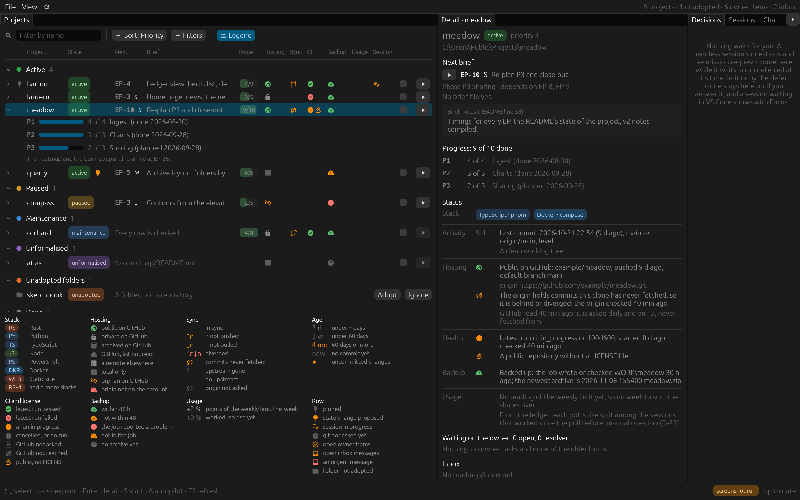

# clauderoadmapwrangler

A Rust desktop dashboard and session launcher for a portfolio of software projects developed with
Claude Code as session-sized roadmap briefs. One window shows every project's next brief with its size
and badges, starts a session visually (the VS Code extension) or headless with a chosen model and effort,
routes a headless session's questions to a decisions pane, keeps the owner's inter-session tasks and a
cross-project inbox, chains briefs on autopilot within caps, meters the account's usage, shows hosting and
backup status and history graphs, hosts a chat to Claude Code, ships the roadmap method as a plugin, and
ends with a phone view over a Tailscale tailnet.

**Status:** phases P1, the read-only dashboard, and P2, sessions, are done (2026-11-01 and
2026-11-04). The Cargo workspace, `crw doctor`
and CI (EP-1), the registry of managed projects with discovery and `crw scan` (EP-2), the roadmap parser
with `crw roadmap` (EP-3 the phase tables, EP-4 the briefs, the decision log and the HEAD-plus-working-tree
snapshot that tells a session in progress), the owner's tasks, the cross-project inbox and the older forms
of the owner's to-dos with `crw tasks` and `crw tick` (EP-5), the dashboard's shell (EP-6: the docking
layout, the project list grouped by state, the detail pane, ticks and Adopt from the window) and its
badges with `crw status` (EP-7: stack, progress, activity, hosting with a check of the origin's head, CI
and license, backup age; EP-7a: columns sized to their content under a header row, and a legend of every
mark) exist; the P1 re-plan (EP-8) measured the phase and opened this repository. In phase P2, the
session runner (EP-9) starts a headless Claude Code session in a project's folder with
the project's neighbour folders read-only, reads its stream-json, answers its questions and permission
requests, stops it with its whole process tree and records it in the ledger; the launch dialog (EP-10)
generates the house-style opener for a project's next brief, resolves its model, effort and permission
mode through a rule table with the reason for each, and starts the session from the window, which
holds it. Adopt writes a new project's own
single-folder VS Code workspace file beside it, and a proposed state can be dismissed until the fact
it rests on changes (EP-33). The dialog launches visually too (EP-11): it opens the project's own
workspace file in VS Code and fills the prompt into a new Claude Code tab of that window, for the
owner to send. The window listens on the loopback for Claude Code's hooks and status line, which
`crw signals install` sets up in the user settings, and asks Claude Code for its live sessions, so
the sessions started elsewhere show beside its own (EP-12). The Sessions pane is a tile (EP-13): a tab
per headless session with its transcript as it streams, Stop and Kill, Resume with a message, and a
list of every session with the ledger's rows, which `crw sessions` prints too. The Decisions pane is
a tile too (EP-14): a headless session's questions and permission requests are answered there while
it waits, a project may give them a time limit after which the run is deferred until the answer
resumes it, a documented defer-and-resume route stands in when a CLI release breaks the control
protocol, and a session waiting in VS Code is listed with Focus. A panic leaves its report in
`crash.log` in the local folder, and the next start names it in the status bar (EP-14a). A popup of
the window's own tells the owner when a session waits for them, has finished or has failed, a tray
icon counts what waits, and closing the window leaves it in the tray with its sessions going on
(EP-15). Each session's start is recorded: the project's HEAD, its branch and a copy of its
uncommitted files, kept in the backups folder. `crw revert` puts a project back as it was when a
session started, after copying the session's work out; it never pushes, and it is refused while
a session works there or when the remote has one of the session's commits (EP-15b). The window
previews the same revert in a dialog, from an ended session's tab, a ledger row of the Sessions
pane or a project's row menu, and reads the plan again before it reverts (EP-15c). The P2 re-plan
(EP-16) measured the phase and made the switch planned from the start: from EP-17 on, this
project's own briefs are started from the tool, as visual launches by default. The usage meter
(EP-17) shows the account's weekly, Fable and five-hour usage in the status bar and a pane of its
own, with notifications at 80 % and 95 %. Each poll's rise is split among the sessions the
window saw work since the poll before, so each session's row in the ledger keeps its share of the
week, which the Sessions pane shows and `crw sessions` sums per project (EP-18a). Each project's
sum, in points of the weekly limit, is a badge of its row, a line of its Detail pane and a sort
key (EP-18b). A visual or manual session from the ledger reopens in a Claude Code tab of its
project's VS Code window from the Sessions pane, and each resumed run gets a ledger row of its own
(EP-35). The Chat pane (EP-24) hosts a read-only Claude Code session over the portfolio: each
message is a turn of one session, kept in the ledger and listed by `crw chats`, with a digest of
every project's standing appended to its system prompt; the session is confined to the projects'
folders by `--restricted`, a project marked as a data repository is never given to it, and it
writes nothing. Its replies draw as Markdown, the ledger's conversations are listed in the pane
and picked up again, each conversation has its own model and effort, and the session's questions
are answered in the pane with the Decisions form (EP-24a). A reply may offer actions, drawn as
buttons under it that open the window's own dialogs with the project filled in (Adopt, which
asks first whether the folder is a data repository, Formalise…, Migrate…, Compose… with the
words typed), nothing written before the owner's click there; the session runs the tool's own
`crw` reading commands under exact permission rules, and an `@<project>` in a message gives it
that project's context as the prompt hook gives an interactive session (EP-24b). The roadmap is
[`roadmap/README.md`](roadmap/README.md), the decisions
[`DECISIONS.md`](DECISIONS.md), the session rules [`CLAUDE.md`](CLAUDE.md).




*Both pictures show the fake portfolio tracked in `crates/app/fixtures/portfolio`, taken by the app of
its own window (`--features screenshot`, below) from a copy at a neutral path.*

## Building

Windows 11 with Rust 1.98 (MSVC) and, for the features that drive them, the Claude Code CLI, the GitHub
CLI `gh`, VS Code with the Claude Code extension, and Tailscale.

```powershell
cargo build --release                   # target\release\clauderoadmapwrangler.exe and crw.exe
pwsh -File scripts\install-shortcut.ps1 # rebuilds, installs (crw install), then a desktop shortcut
                                        # and a Start-menu entry that open the installed window
target\release\crw.exe install          # copy the build into %LOCALAPPDATA%\clauderoadmapwrangler\bin
                                        # (and the plugin's copy beside it) and ask the window to
                                        # restart into it
target\release\crw.exe doctor           # versions of claude, gh, tailscale, code and the extension,
                                        # where the installed copy is, which crw.exe the hooks run,
                                        # whether the plugin's copy matches the build, and whether
                                        # claude would start a headless session
target\release\crw.exe scan             # the registry: projects, unadopted folders, proposals
target\release\crw.exe dismiss <project>          # leave its proposals out until their facts change
target\release\crw.exe roadmap <folder> # a project's snapshot: the next EP, its brief notes and brief,
                                        # the decision log, whether a session is in progress
target\release\crw.exe tasks <folder>   # what waits on the owner: tasks, inbox, handed-on blocks
target\release\crw.exe tick <folder> OT-n         # tick an owner task
target\release\crw.exe tick <folder> IN-n <text>  # tick an inbox message with its disposition
target\release\crw.exe send <folder> <words> [--urgent]  # write a message from you into its inbox
target\release\crw.exe mail [--all]               # the mailman's log: first readings, deliveries
target\release\crw.exe status [--offline]         # every project's badges; asks git, gh, the origins
target\release\crw.exe setting <key> <value>      # set a registry setting, such as backup_settings
target\release\crw.exe prompt <folder> [--visual|--headless]
                                        # what a launch of the next brief starts from: the launch
                                        # mode, model, effort and permission mode with their
                                        # reasons, the downshift's judgement, the prompt worded
                                        # for the mode
target\release\crw.exe sessions [<folder>] [--all]  # the ledger's sessions, the newest first; reads only
target\release\crw.exe revert <project> [<id>]    # preview undoing its latest session, or the one named
target\release\crw.exe revert <project> <id> --yes  # copy the work out, then put the project back
target\release\crw.exe set <project> revert no    # record no session starts there, and allow no revert
target\release\crw.exe notifications [--all]      # the window's notifications and badges; reads only
target\release\crw.exe setting quiet_hours 22:00-07:00  # hold notifications back at night; none undoes it
target\release\crw.exe setting ntfy_host ntfy.example  # push each popup to this ntfy server too
target\release\crw.exe setting ntfy_topic <topic>      # ...on this topic; none for either turns it off
target\release\crw.exe usage            # the usage meter's readings and changes of state; reads only
target\release\crw.exe setting usage_endpoint off  # keep the meter on the status lines; on undoes it
target\release\crw.exe setting fable_downshift_percent 70  # the downshift's mark; default undoes it
target\release\crw.exe signals          # the hooks and status line in Claude Code's user settings,
                                        # whether a window listens, what an install would change
target\release\crw.exe signals install [--inbox]  # write them, after a dated copy of the file
target\release\crw.exe signals remove   # take them out again
```

The tool keeps its registry, a hand-editable `registry.toml`, in `%APPDATA%\clauderoadmapwrangler`, and
its ledger and the copies it makes before changing a file in `%LOCALAPPDATA%\clauderoadmapwrangler`;
nothing is kept in a project. Both exes run from an installed copy in that local folder's `bin`, so a
release build never meets the running window or a hook: `crw install` copies the build there, each
installed exe renamed to a dated previous copy first (Windows lets a running exe be renamed, not
replaced), and asks the window to restart into it. The window does so at once, starting the installed
window and closing, unless something would be lost, such as a headless run of its own that works or
waits; a refused request is not remembered, and File > Install and restart, or the tray's item, does it
later. While a newer build is installed the launch dialog says so too, since a session started from
it would run in the older window, and its own Install and restart closes the dialog, restarts the
window and opens the dialog again there. Between two runs of a chain the autopilot takes a newer installed build itself, at the gate's
moment: the held chains and the chain plans cross the restart in a handover file, and the next
brief starts in the new window once its first poll of live sessions has answered. A chain that ends
leaves the window as it is. The status bar says when a newer build waits. The registry lists the folders of one data root (by default the folder
that holds this repository); `crw adopt` registers a folder, writes its own single-folder
`<folder>.code-workspace` beside it unless one is there, and adds it to the aggregate VS Code workspace
file; `crw ignore` hides one, `crw set` changes a project's state, priority, pin or time limit for
its sessions' requests, and `crw dismiss`
leaves a proposed state out until the fact it rests on changes (`crw undismiss` brings it back). Set
`CRW_HOME` to a scratch folder to try the commands without touching those folders.

The window (`clauderoadmapwrangler.exe`, the "Roadmap Wrangler" shortcut) shows the registry's projects
grouped by state, each with its next brief, its progress, what waits on the owner (the open owner
tasks and inbox messages of a project that keeps `roadmap/owner-tasks.md`, else the open items of its
older forms), its badges (this
week's share of the usage among them) and whether a session is in progress, in columns as wide as
their widest value under a header row, the brief's title giving way before a badge column does; the
Legend switch shows a key to every mark; a click anywhere on a row selects it and a right click opens
its menu. The detail pane shows the selected project's brief notes, status, owner items, inbox,
handed-on mail, the risks and older forms of a project with a tasks file (read-only, counted
nowhere) and problems, the notes set for reading: each `From …:` segment under its label,
numbered parts as a list, lines of about a hundred characters, and labels, references, gates and
runnable code in three colours of the window's, a long owner item a sentence to a bullet with its
gate as a chip beside its id.
It reads each project's files at once and adds what git says one
repository at a time; GitHub (through `gh`) and each origin's head are asked daily and on F5, the
answers cached in the ledger, and nothing is ever fetched. The backup badge reads an existing backup
job's settings file and run log, named by the `backup_settings` and `backup_log` settings. It writes
only what the tool owns: the registry (Adopt, Ignore, a confirmed or dismissed proposal, pin,
priority), the workspace files Adopt writes (and a visual launch, when a project's own one is
missing), the ledger's rows and the ticks in a project's `owner-tasks.md` and `inbox.md`. S,
or a row's Start button, opens the launch dialog on the selected project's next brief: the
generated prompt in an editor, a Visual | Headless switch, and the model (from
the catalog Claude Code caches), the effort, ultracode and the permission mode, each with the reason
the rule table gave it. A project's `[project.launch]` in the registry sets its defaults (`mode`
among them) and a prompt `template`; `[[rule]]` tables, global or per project, match a brief by
size, phase or title words and set its model, effort or an effort step. Every rule that matches
applies, an earlier one over a later one for each value it sets, and a project's rules come after
the global ones. The pins beside the dialog's Model and Effort pickers keep the value shown for
every brief of the project, or for the brief's phase, as a rule the tool writes and names, or take
it back to the rules; `crw set <project> model|effort <value|default>` keeps one for every brief,
and a chain plan's rows the owner left alone follow at once. Last comes the Fable
downshift: while the meter's Fable-scoped figure is above `fable_downshift_percent` (60 % by
default), an S brief that would run on Fable is proposed Opus 5.5 at the same effort, and the
dialog says how it judged the figure. Open in VS Code, for
Visual (the default), opens the project's own workspace file, which brings its window to the front
or opens it, and fills the prompt into a new Claude Code tab there, where the owner chooses the
model and effort and sends it: the link carries the prompt alone, so in Visual the dialog's model,
effort and ultracode pickers are greyed out, and the opener names the rules' suggestion. Start headless runs the session and gives it a tab in the Sessions
pane: its transcript as it streams (the assistant's text, each tool call in one line with its result
collapsed under it, what it asked, what was refused, the result), Stop and Kill while it runs, and,
once it has ended, Resume, which runs it again under its session id with the message typed there.
The pane's All tab lists every session, the window's, those started elsewhere and the ledger's
latest rows, filtered by project, mode and running only. A ledger card of a visual or manual
session has Resume in VS Code: it opens the project's window and hands the extension the session's
id, so that the conversation opens in a tab, ready for the next message. A headless run's is
greyed out, since the extension opens one as an empty tab; `claude --resume <id>` in a terminal
takes it up, the id being on its card. The transcript stays in the window's memory: the tool
writes none and reads none.

The autopilot chains a project's briefs within caps. A project's box in the list (or A) turns it
on, the owner's standing yes to that project's commits: its sessions then commit in the house
pattern, record the hash in the roadmap and never push. With it off, a headless session stops
before committing and its ended tab offers Commit, which resumes it with that yes. When a headless
run of a project with the autopilot on completes, a gate reads the project afresh and names every
condition that fails: the brief's completion note and its checked row, the next brief not a
re-plan and no larger than M, no owner task due before it, a clean tree, the day's caps (2 chained
runs a project, 4 in all), the weekly and Fable figures under 90 % (and recent enough to trust),
no other session working or waiting there (an idle tab is named, not counted), and runs that
would not wait at every shell command (a permission mode of `auto`, or allow rules). Ticking the
box of a project whose runs would wait offers `auto` first, with what it means; the launch
dialog's pin beside Permissions keeps a mode for the project or takes it back, and `crw set
<project> permission_mode <mode|default>` does the same from a shell. Since `auto` lets a plain
push to the project's own remote through, every headless run of a project whose autopilot is on
also gets a deny rule that refuses `git push` as written. If the gate passes, the next brief starts headless as the owner's
chain plan says: the launch dialog of a project whose autopilot is on lists the briefs a chain
may run after the one being started, each with a Chain box and the same Model and Effort
pickers, the rules' resolution the default, so the chain runs a brief as the owner set it, the
rules' way where they left it alone, and ends before a brief they unticked. If only the pause
refuses, the chain is held until the pause lifts. Each such run has a cap by size (S 45 min, M 90
min, L 3 h) counted in working time, a question's wait left out, and is stopped gracefully at it.
Pause, in the Sessions pane or the tray, holds every chain; the runs that work go on. The
Sessions pane's All tab opens with the chain log, the plans in hand and a line for each project
whose autopilot is on: its permission mode, what the gate would refuse it for between runs (runs
that would wait, sessions open there) and its limits as pickers, the largest brief, the runs a day
and a budget a run (`crw set <project> max_size|daily|max_budget_usd` takes any figure). `crw
autopilot` prints the log; each change of a chain's state, a brief chained, a hold or an end, is
a notification of its own, whose Show opens that tab. The tool's own project chains like any other:
its briefs end with the install, and the window restarts into each brief's build before the next.

The Decisions pane answers what a headless session asks while it waits: a permission request with
Allow or Deny (its tool, its call, why it asks and its input shown; a reason optional), a question
with its options, one or several, or the owner's own words, sent or declined. A project's
`answer_timeout` (`crw set <project> answer_timeout <minutes|none>`, none by default) defers a run
whose request waits that long: the request is refused, the turn ends, and the answer given later
in the pane resumes the session with it. With `crw setting decisions defer`, or by itself for the
later runs of a CLI that refused the control protocol's handshake, the window takes Claude Code's
documented defer-and-resume route instead: a `PreToolUse` hook (`crw.exe hook --defer`) ends a run
at each question, and the answer resumes the session without a prompt through a one-shot hook
(`crw.exe hook --answer <file>`). A session Claude Code reports waiting elsewhere is listed too,
never answered: Focus brings its VS Code window forward. The ledger keeps how many questions a run
asked and how long the answers took.

The window also listens on `127.0.0.1` (the registry's `port`, 47831 by default) for Claude Code's
hooks (SessionStart, Notification, Stop, SessionEnd, UserPromptSubmit) and its status line, which `crw signals install`
writes into the user settings to run `crw.exe hook` and `crw.exe statusline` (the installed copy once
there is one): each reads the
session's input, keeps the session's id, folder and event (or the status line's model, cost, context
and rate limits, never a transcript's text) and posts them within half a second, printing nothing
and exiting quietly when no window listens. With `--inbox` the start hook also prints the project's
open inbox messages into the session. A prompt typed in a session that names a registered project
as `@<project>` (outside code, at most three) is given that project's next row with the start of its
brief notes, its rules in short (each numbered rule's first sentence, none cut in the middle) and
the paths of its `CLAUDE.md` and roadmap, within Claude Code's limit on a hook's output; the prompt's
text never leaves the relay, and
a headless run's prompt, a program's, is given nothing. The window asks `claude agents --json` for the live sessions
every 5 s while it has the focus (every 30 s otherwise), matches each session's folder to a
registered project, and lists the sessions started elsewhere (visual, headless or by hand; busy,
waiting, idle or ended) in the Sessions pane and as a session in progress in the project's row. A
session gets its ledger row at its first sign of work (a finished turn, a wait for the owner, or the
poll seeing it busy), so a tab opened and left unused, a helper the extension starts and a tab a
window restores leave none; a visual launch no session takes up within 30 minutes lapses. A
session resumed after its row ended gets a row per run under the same id: visual when the window
handed it to VS Code, manual otherwise.

The window calls the owner with a popup of its own: a small window at the screen's lower right,
always on top, that takes no keyboard focus and has no taskbar button (Windows' toasts can be off,
and the popup does not depend on them). A notification comes when a session waits for an answer or
a permission (one of the window's headless runs, a run deferred at its time limit, or a session
Claude Code reports waiting in VS Code or a terminal), when a run finishes (saying the first
sentence of its result's first paragraph) or fails, when a session elsewhere ends a turn of two
minutes' work or more, and when a message flagged `[urgent]` arrives in a project's inbox from
anyone but the owner. The popup lists the latest, the newest
first, each with Show, which brings the window forward on the pane that matters or the VS Code
window a session waits in, and Dismiss; they stay until dismissed. Notifications are held back in
the registry's quiet hours (`crw setting quiet_hours 22:00-07:00`, none by default) and while the
window is in front, where the status bar says them instead; File, Send a test notification puts one
in the popup. With `crw setting ntfy_host <server>` and `crw setting ntfy_topic <topic>`, each
notification the popup shows is also pushed to that [ntfy](https://ntfy.sh) server for the phone
(`https://` unless the host is written `http://`; urgent messages at ntfy's `urgent` priority, waits,
failures and usage marks at `high`), and the test is pushed too. When the ntfy server runs on the
window's own PC, `ntfy_host` is best its loopback address (`http://127.0.0.1:<port>`): a VPN client
on the PC can leave the server's name on a private network such as a tailnet unreachable from the
PC itself, while the phone keeps that name. ntfy's iOS app takes a self-hosted server only when the
server's `upstream-base-url` is `https://ntfy.sh` and its `base-url` is, character for character,
the URL typed into the app (both sides hash it); the app fetches each message's text from the
server, so while the phone cannot reach it the banner says only "New message" and the text waits
in the server's cache until the app is next opened. The tray icon counts what waits for the owner and marks what is new since the window
was last in front: an unadopted folder, a remote or a backup to look at, an inbox message. A left
click on it shows the window; its menu shows the window too, opens the launch dialog on a pinned
project's next brief, or quits. Closing the window leaves it in the tray with its headless sessions
going on, and Quit asks first when it would stop them. Each notification and what became of it,
each Show and each badge is a line in the ledger, which `crw notifications` prints.

The window is also the mailman between projects (D-13). A brief's `> **Handed on (to <project>).**`
block to a registered project is appended to that project's `roadmap/inbox.md` as a new `IN-n` line
once its words are committed (the brief's copy at `HEAD` holds them), while no session works or
waits there; the status bar says so, the receiving row shows the message, and the Detail pane says
what became of each block, a reworded block, sent again, naming the message it rewords. Each delivery
is a line in the ledger, which `crw mail` prints, and a revert of a session in the receiving project
puts the message back. The owner writes a message of their own from the Detail pane's Compose… or a
row's Send a message… (or `crw send`): it goes into the project's inbox at once as
`IN-n (from the owner, <date>)`, with `[urgent]` at its end when flagged, even while a session works
there (the dialog says so: the next session triages it), and is logged like a delivery, so a revert
puts it back too.

The usage meter (EP-17) polls the undocumented `GET https://api.anthropic.com/api/oauth/usage`,
treated as breakable, every 5 minutes, soon after a session the tool launched ends, and with a
backoff from 1 to 30 minutes while it fails. Each poll reads the OAuth token from Claude Code's
`.credentials.json` at that moment and sends it to that host alone, through WinHTTP, Windows' own
HTTP stack; the token is never written, logged or shown. The status bar shows the weekly limit, the
Fable-scoped one and the five-hour window while it is open, each a small bar with its percent
(amber from 80 %, red from 95 %). The Usage pane shows each limit with its reset countdown, the
week's use by surface, extra usage and a sparkline of the last seven days. The status lines' rate
limits are the meter's second series: when the endpoint fails, it shows the newest figures it has,
marked degraded with the reason. A notification comes when the weekly or the Fable limit passes
80 % and 95 %, once per mark in each limit window. Each reading is a sample in the ledger, which
`crw usage` prints with the meter's changes of state; `crw setting usage_endpoint off` keeps the
meter on the status lines alone. Each poll's rise is split among the sessions the window saw work
since the poll before, manual ones too, and each project's sum since the weekly reset is the Usage
badge of its row, in points of the weekly limit (`+6 %`); its hover text and the Detail pane add
its Fable sum and its part of all that was attributed, and the Usage share sort key ranks by it.

Built with `--features
screenshot` and run with `CRW_SCREENSHOT=<file.png>`, it shows a fake portfolio
(`crates/app/fixtures/portfolio`), saves a picture of its own window and exits;
`CRW_SCREENSHOT_SETUP` arranges the view (see `crates/app/src/screenshot.rs`).
`CRW_SCREENSHOT_ROOT=<folder>` points such a run at another data root under the same guards: a
scratch copy of real roadmap files that `scripts\copy-roadmap.ps1` makes one project at a time, read
with a registry written from its folders, so that a layout can be checked on real content without
the pictures leaving the machine.

The workspace has three crates: `crates/core` (the model and engines, no UI types), `crates/app` (the
desktop window, `clauderoadmapwrangler.exe`, with its loopback server) and `crates/cli` (`crw.exe`, the
console commands and the hook and status-line relays). The checks every change passes: `cargo test`
with and without `--features screenshot`, `cargo clippy --all-targets` with and without it, `cargo fmt
--check`. Tests never run the real `claude` CLI and never spend usage: the session runner's tests start
`stub-claude`, a stand-in built with the core crate that replays recorded stream-json with fake names,
and the signals' tests bind a free loopback port and write scratch settings files.

## The roadmap house style

The tool reads each project's roadmap files in the shape below; this repository's own `roadmap/` folder
is a complete example. Two older shapes (a five-column table and a "work packet" style) are read through
format profiles, read-only. `crw roadmap <folder>` prints what the parser reads in one roadmap. The
plugin's [reference](plugins/roadmap-wrangler/reference/house-style.md) gives the schema in full.

- **Phase tables.** `## Phase P1 — <name> (<status>)` headings, each followed by a table with the header
  `| # | Brief | Size | Depends on | Core | Done |`. One row per brief: an `EP-n` id; a one-line summary,
  optionally a link to the brief file, with the decisions it rests on as `D-n`; the size `S`, `M` or `L`
  (about 30 minutes, 1 hour and 2 hours of one session; a re-scope is written in the cell, such as
  `S → L (…)`); the ids it depends on; `core` or `stretch`; and the Done cell, `☐` or `☑` with one
  backticked commit hash.
- **The next brief** is the first unchecked row in table order, not the lowest number.
- **Brief notes.** Under each table, `**Brief notes.**` and one `- **EP-n.** …` bullet per brief: the
  detail a session starts from.
- **Briefs.** `roadmap/EP-n-<slug>.md`, opened with YAML front matter (`ep`, `title`, `size`, `model`,
  `effort`, `status`), then Context, In scope, Out of scope and Verification / acceptance, and closed by
  `> **Completion note (date; model/effort; duration).**`, which records each owner decision and its
  outcome. The tool reads the roadmap at git `HEAD` and in the working tree and keeps both: a changed
  README, an untracked or changed brief, or the next brief without a completion note (when it is the only
  open brief) means a session is in progress.
- **Decisions.** `DECISIONS.md` entries `**D-n Title.** Decision. *Why.* *Alternatives.*`, refined by
  dated addenda (`> **Addendum (date, EP-n).** …`) and never rewritten.
- **Owner tasks.** `roadmap/owner-tasks.md`, one line per task only the owner can do:
  `- [ ] OT-n (EP-k, date) text`, optionally `before EP-m`. The owner ticks a task in the tool, which
  changes the box and nothing else in the project (a copy of the file goes to the tool's backups folder
  first). Older forms of the owner's to-dos (a README's `## Risks / open items` list struck through when
  resolved, an `Open items for the owner` list, an `**Owner actions outside any brief**` paragraph,
  `owner-decisions.md` and `open-questions.md` registers, handoff notes, and the `Parked` and
  `Handed on` blocks of the latest completed brief) are read and shown, never rewritten.
- **Inbox.** `roadmap/inbox.md`, one line per message from another project:
  `- [ ] IN-n (from <project> EP-k, date) text`, optionally ending `[urgent]`, which notifies the
  owner (the popup, and ntfy when set), never the receiving session. A sending session writes
  `> **Handed on (to <project>).** …` after its completion note and the tool delivers it once the
  block's words are committed and no session works in the receiving project (its first reading of a
  project counts the committed blocks already there as delivered); the receiving
  session triages each open message after reading the roadmap and writes the disposition on the line.
  The owner may tick a message in the tool, which writes `**Disposition (date):** …` on its line,
  and may write one, `- [ ] IN-n (from the owner, date) text`, from the tool or by hand.
- **Formalising a project.** `crw formalise <project|folder>` previews the house-style files a
  project is given and `--yes` writes them: a rule block in its `CLAUDE.md` between
  `<!-- roadmap-wrangler:begin -->` and `<!-- roadmap-wrangler:end -->` (the house's rules in short;
  the text outside the markers is never touched, and the file is copied to the tool's backups
  folder first), `roadmap/owner-tasks.md` and `roadmap/inbox.md` with their headers, and the brief
  template `roadmap/_TEMPLATE.md`; a file that is there is never replaced, and the write is
  refused while a session works in the project. For a roadmap in one of the two older shapes,
  `crw formalise <project> --migration` prints the prompt of a session that converts its tables to
  the house form, keeping every id, hash and file. In the window, a project that lacks one of these
  files offers Formalise… in its row's menu, and its Detail pane shows a House style section when
  that matters (`roadmap/owner-tasks.md` or `roadmap/inbox.md` missing, a refusal, an older roadmap
  or the unformalised state; a missing rule block or template alone leaves the menu item only): the
  same preview in a dialog (each file and its change, the block and the new files' text), then
  Write, which reads the files again first and writes only the plan shown, refused while a session
  works or waits there. For an older roadmap, Migrate… (Migrate the roadmap… in the row's menu)
  opens the launch dialog in Headless with that prompt in place of the opener, for the owner to
  send: the run is labelled `migration`, no chain follows it, and its commit is the owner's. Each
  formalise is a line in the ledger, and a revert of a session that started before it writes the
  house-style files again after the reset, as it redoes the tool's ticks.
- **Re-plans and parked work.** A re-plan brief closes each phase; work named and not built is parked in
  `roadmap/v2-notes.md`.
- **Commits.** `<Title>: <summary> (EP-n, D-x)`, then `docs(roadmap): record EP-n commit hash`.

## The roadmap-wrangler plugin

The method these files follow ships as a Claude Code plugin in this repository,
[`plugins/roadmap-wrangler/`](plugins/roadmap-wrangler): four skills and a reference.

- `/roadmap-wrangler:plan` plans a project through an interview: a verified survey and a research
  pass, a domain map written to the repository first, rounds of four questions with the recommended
  option first, then the decision log, the roadmap, the session rules and the parked notes written
  from the record.
- `/roadmap-wrangler:replan` closes a phase: the walk of its residual risks, the retro timed from
  the session transcripts, dated addenda, the next phase re-cut with pickup notes, the parked notes
  grown.
- `/roadmap-wrangler:formalise` gives a project the house-style files through `crw formalise` (the
  preview, then `--yes` on the owner's word), hands an older roadmap's migration prompt to a session
  in that project, or writes a first roadmap from a brief.
- `/roadmap-wrangler:status` reports a roadmap the way the parser reads it: the next EP, the counts
  and what waits on the owner.
- [`reference/house-style.md`](plugins/roadmap-wrangler/reference/house-style.md) is the schema in
  full, with the texts `crw formalise` writes quoted byte for byte (a test keeps them equal).

Claude Code installs plugins from marketplaces, and this repository is one
([`.claude-plugin/marketplace.json`](.claude-plugin/marketplace.json)). To install the plugin into
your own sessions, in a terminal and in VS Code alike:

```powershell
claude plugin install roadmap-wrangler --marketplace willtfarrington/clauderoadmapwrangler
# or in two steps, checking out only the plugin's folders:
claude plugin marketplace add willtfarrington/clauderoadmapwrangler --sparse .claude-plugin plugins
claude plugin install roadmap-wrangler@clauderoadmapwrangler
# later, to take what was pushed since:
claude plugin update roadmap-wrangler@clauderoadmapwrangler
```

The one-step form needs a Claude Code whose `claude plugin install` takes `--marketplace` (2.1.316
does); the two steps work on older ones. The install copies the plugin as of the repository's last
push. The plugin names no `version`, so each push that changes it is a release, which `claude
plugin update` takes (Claude Code does not update a third-party marketplace by itself unless its
auto-update is turned on under `/plugin`). Inside a session, `/plugin` opens the same choices.

To follow a local clone instead, register the marketplace by the clone's path: `claude plugin
marketplace add <clone folder>`, then `claude plugin install
roadmap-wrangler@clauderoadmapwrangler`. The plugin then loads in place from the working tree at
each session start, unfinished edits included. One name holds one marketplace, so to switch
routes, `claude plugin marketplace remove clauderoadmapwrangler` first, which uninstalls the
plugin too. To try it in one session without installing it, start `claude --plugin-dir
plugins\roadmap-wrangler` in the clone. The tool's own headless runs load it that way: the build
carries the plugin's files and writes its copy under
`%LOCALAPPDATA%\clauderoadmapwrangler\plugin\roadmap-wrangler\` before each start (and at `crw
install`), then passes `--plugin-dir` with that folder, which replaces an installed plugin of the
same name for that session; the launch dialog's Plugin field and `crw doctor` say so. A visual
launch cannot pass the flag, so a VS Code session has the plugin once it is installed.

## Notes

Built for one developer's workflow: one user, one house style, configurability only where it costs
nothing. The tool drives the user's own installed Claude Code CLI and claude.ai login; it offers neither,
and it never stores the login's token. Developed with AI assistance (Claude Code), reviewed and directed by
the owner. License: [MIT](LICENSE).
