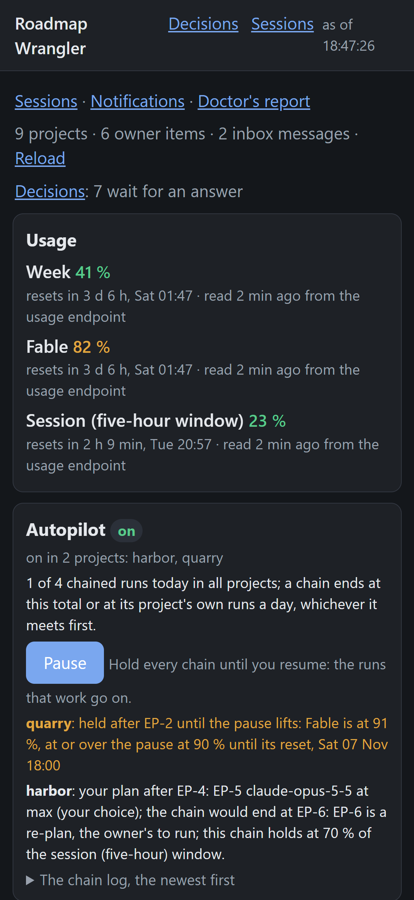

# clauderoadmapwrangler

A Rust desktop dashboard and session launcher for a portfolio of software projects developed with
Claude Code as session-sized roadmap briefs. One window shows every project's next brief with its size
and badges, starts a session visually (the VS Code extension) or headless with a chosen model and effort,
routes a headless session's questions to a decisions pane, keeps the owner's inter-session tasks and a
cross-project inbox, chains briefs on autopilot within caps, meters the account's usage, shows hosting and
backup status and history graphs, hosts a chat to Claude Code, ships the roadmap method as a plugin, and
ends with a phone view over a Tailscale tailnet.

## State of the app

**v1 is complete** (2026-11-17). Planned in a 72-question interview on 2026-10-31 as 32 session
briefs and grown to 69 as it ran, it is done in five phases: P1 the read-only dashboard, P2
sessions, P3 automation, usage, the cross-project inbox and the method plugin, P4 the chat,
analytics, exports and diagnostics, P5 the phone view. The tool has run its owner's portfolio
since P1, and it has started its own briefs since P2's close: as visual launches into VS Code at
first, then as headless runs it chains by itself, restarting into each brief's build between two
runs. v2 opens with one fix and a planning interview of its own; its direction leads with Claude
Code's background sessions, a worktree per session, usage over time and free chat from the phone.
The roadmap is [`roadmap/README.md`](roadmap/README.md), the decisions [`DECISIONS.md`](DECISIONS.md),
the session rules [`CLAUDE.md`](CLAUDE.md), and the work parked for v2
[`roadmap/v2-notes.md`](roadmap/v2-notes.md). The user's manual is
[`docs/manual.md`](docs/manual.md): the window pane by pane, the launches, the autopilot, the
mail, the phone view, every `crw` command and the files the tool keeps, what to do when
something goes wrong, and a walkthrough of the routes no real use has met yet; what changed for
a user since it was last brought up to date is in
[`docs/manual-changes.md`](docs/manual-changes.md).

What it does, by area (the sections below give the detail):

- **Projects and roadmaps.** A registry of the projects under one data root, with new folders
  found and adopted from the window (each given its own VS Code workspace file), and a parser of
  the house-style roadmap (phase tables, briefs, decision logs, owner tasks and the inbox; two
  older shapes read only) that reads each project at git `HEAD` and in the working tree and tells
  a session in progress. The list shows every project's next brief with its size, its progress,
  what waits on the owner and its badges (stack, hosting, sync, activity, CI and license, backup,
  the week's usage share); the Detail pane shows the brief notes set for reading, the status, the
  history and the graphs. Formalise… (and `crw formalise`) gives a project the house-style files,
  and Migrate… hands an older roadmap to a session that converts it.
- **Launching sessions.** The launch dialog writes the house-style opener for the next brief and
  resolves its model, effort and permission mode through a rule table, with a Fable downshift
  while that limit runs high. Visual fills the prompt into a new Claude Code tab of the project's
  VS Code window; Headless runs the session in the window, read through stream-json, with the
  project's neighbour folders read-only.
- **Sessions and decisions.** The Sessions pane holds each headless run's transcript as it
  streams, with Stop, Kill and Resume, and lists every session the hooks and `claude agents
  --json` report, each that works kept in the ledger. The Decisions pane answers a headless run's
  questions and permission requests, with an optional time limit that defers the run until the
  answer comes.
  A session can be reverted to its recorded start, its work copied out first, and a visual or
  manual one resumed in VS Code.
- **The autopilot.** A project's box chains its next briefs after a headless run, once a gate
  passes: the brief done and committed, a clean tree, no owner task due, the day's caps, the
  weekly, Fable and five-hour figures under their marks, no other session at work. Each run is
  capped by its size in working time and follows the owner's chain plan of models and efforts,
  with a deny rule against `git push`; the window restarts into a newer installed build between
  two runs, carrying the chain.
- **Usage.** The account's weekly, Fable and five-hour figures, read from Claude Code's usage
  endpoint with the local login, in the status bar and a pane, with a notification when the
  weekly or the Fable limit passes 80 % and 95 %; each poll's rise is split among the sessions
  that worked.
- **Notifications.** The window's own popup (Windows' toasts may be off), a tray icon that counts
  what waits, quiet hours, and each notification pushed to an ntfy server for the phone.
- **Mail between projects.** A brief's `Handed on (to <project>)` block is delivered into the
  receiving project's inbox once it is committed, and the owner writes messages from the window.
- **The chat.** A read-only Claude Code session over the portfolio in the Chat pane, whose replies
  offer the window's own dialogs as buttons.
- **History and analytics.** Each project's history imported from git and its briefs' notes; a
  heatmap, a burn-up, a velocity and a projection; sparklines in the list, and a cards view.
- **Hosting, backup and exports.** Create a private remote, Make public (after a word check of the
  whole history), Make private, Remove the remote, an orphan's Archive and Delete, and Back up now,
  each behind a confirmation that names the command; the site's cards, a daily JSON export and a
  CSV.
- **Diagnostics and operations.** `crw doctor` and a Diagnostics pane with the same checks; a
  rolling log and a crash log; an installed copy that a release build never meets, a start at
  login hidden in the tray, one window per machine, and `crw` on PATH.
- **The phone view.** The window's pages under `/m/` (the list, a project, the decisions, the
  sessions and a run's own page, the notifications, the doctor's report) with a few actions
  (tick, answer, compose, start, stop, pause, check again), put on the owner's tailnet by
  Tailscale Serve behind the owner's login.
- **The plugin.** The roadmap method as a Claude Code plugin with four skills: plan, replan,
  formalise and status.


*Both pictures show the fake portfolio tracked in `crates/app/fixtures/portfolio`, taken by the app of
its own window (`--features screenshot`, below) from a copy at a neutral path.*

## Building

Windows 11 with Rust 1.98 (MSVC) and, for the features that drive them, the Claude Code CLI, the GitHub
CLI `gh`, VS Code with the Claude Code extension, and Tailscale.

```powershell
cargo build --release                   # target\release\clauderoadmapwrangler.exe and crw.exe
pwsh -File scripts\install-shortcut.ps1 # rebuilds, installs (crw install), then a desktop shortcut
                                        # and a Start-menu entry that open the installed window
target\release\crw.exe install          # copy the build into %LOCALAPPDATA%\clauderoadmapwrangler\bin
                                        # (the plugin's copy and the app's icon beside it, the copy
                                        # on PATH refreshed) and ask the window to restart into it
target\release\crw.exe autostart [on|off]  # the start-at-login entry: start the installed window
                                        # hidden in the tray when you sign in (File > Start at login)
target\release\crw.exe path [on|off]    # a copy of crw.exe in %USERPROFILE%\.local\bin, so `crw`
                                        # runs from any shell
target\release\crw.exe doctor           # the Diagnostics pane's checks by group: the tools, the
                                        # exes and the hooks, gh's login, Tailscale, the backup
                                        # drive, the registry and the ledger, the crash log and
                                        # the rolling log, the last readings, VS Code; then
                                        # whether claude would start a headless session
target\release\crw.exe scan             # the registry: projects, unadopted folders, proposals
target\release\crw.exe dismiss <project>          # leave its proposals out until their facts change
target\release\crw.exe roadmap <folder> # a project's snapshot: the next EP, its brief notes and brief,
                                        # the decision log, whether a session is in progress
target\release\crw.exe tasks <folder>   # what waits on the owner: tasks, inbox, handed-on blocks
target\release\crw.exe tick <folder> OT-n         # tick an owner task
target\release\crw.exe tick <folder> IN-n <text>  # tick an inbox message with its disposition
target\release\crw.exe send <folder> <words> [--urgent]  # write a message from you into its inbox
target\release\crw.exe mail [--all]               # the mailman's log: first readings, deliveries
target\release\crw.exe status [--offline]         # every project's badges; asks git, gh, the origins
target\release\crw.exe setting <key> <value>      # set a registry setting, such as backup_settings
target\release\crw.exe prompt <folder> [--visual|--headless]
                                        # what a launch of the next brief starts from: the launch
                                        # mode, model, effort and permission mode with their
                                        # reasons, the downshift's judgement, the prompt worded
                                        # for the mode
target\release\crw.exe sessions [<folder>] [--all]  # the ledger's sessions, the newest first; reads only
target\release\crw.exe revert <project> [<id>]    # preview undoing its latest session, or the one named
target\release\crw.exe revert <project> <id> --yes  # copy the work out, then put the project back
target\release\crw.exe set <project> revert no    # record no session starts there, and allow no revert
target\release\crw.exe notifications [--all]      # the window's notifications and badges; reads only
target\release\crw.exe setting quiet_hours 22:00-07:00  # hold notifications back at night; none undoes it
target\release\crw.exe setting ntfy_host ntfy.example  # push each popup to this ntfy server too
target\release\crw.exe setting ntfy_topic <topic>      # ...on this topic; none for either turns it off
target\release\crw.exe remote           # the phone's remote-action log: actions, refusals, arrivals
target\release\crw.exe setting owner_login <login>  # the login the phone's pages answer through Serve
target\release\crw.exe setting remote_view none     # take remote view's record out by hand
target\release\crw.exe usage            # the usage meter's readings and changes of state; reads only
target\release\crw.exe setting usage_endpoint off  # keep the meter on the status lines; on undoes it
target\release\crw.exe setting fable_downshift_percent 70  # the downshift's mark; default undoes it
target\release\crw.exe signals          # the hooks and status line in Claude Code's user settings,
                                        # whether a window listens, what an install would change
target\release\crw.exe signals install [--inbox]  # write them, after a dated copy of the file
target\release\crw.exe signals remove   # take them out again
```

The tool keeps its registry, a hand-editable `registry.toml`, in `%APPDATA%\clauderoadmapwrangler`, and
its ledger and the copies it makes before changing a file in `%LOCALAPPDATA%\clauderoadmapwrangler`;
nothing is kept in a project. Both exes run from an installed copy in that local folder's `bin`, so a
release build never meets the running window or a hook: `crw install` copies the build there, each
installed exe renamed to a dated previous copy first (Windows lets a running exe be renamed, not
replaced), and asks the window to restart into it. The window does so at once, starting the installed
window and closing, unless something would be lost, such as a headless run of its own that works or
waits; a refused request is not remembered, and File > Install and restart, or the tray's item, does it
later. While a newer build is installed the launch dialog says so too, since a session started from
it would run in the older window, and its own Install and restart closes the dialog, restarts the
window and opens the dialog again there. Between two runs of a chain the autopilot takes a newer installed build itself, at the gate's
moment: the held chains and the chain plans cross the restart in a handover file, and the next
brief starts in the new window once its first poll of live sessions has answered. A chain that ends
leaves the window as it is. The status bar says when a newer build waits. A second window started
by hand finds the first over the loopback port, asks it to show itself and quits, so one window
holds the port, the hooks and the meter (EP-40). File > Start at login (or `crw autostart on`)
registers the tool's own start-at-login entry, the value "Roadmap Wrangler" under the user's Run key,
which starts the installed window hidden in the tray when you sign in; a start at login that finds a
window already running quits without showing it. When a window first holds the port and its poll of
live sessions answers, it closes the ledger's rows whose end no window heard: a visual or manual
session's tab closed while no window ran, or a headless run whose window crashed. Each ends at its
transcript's last write (the file's time, its contents never read) and keeps a note saying so, and
the Diagnostics pane names what was closed (EP-28a). The window, the tray and the shortcuts show the
tool's own icon. The registry lists the folders of one data root (by default the folder
that holds this repository); `crw adopt` registers a folder, writes its own single-folder
`<folder>.code-workspace` beside it unless one is there, and adds it to the aggregate VS Code workspace
file; `crw ignore` hides one, `crw set` changes a project's state, priority, pin or time limit for
its sessions' requests, and `crw dismiss`
leaves a proposed state out until the fact it rests on changes (`crw undismiss` brings it back). Set
`CRW_HOME` to a scratch folder to try the commands without touching those folders.

The window (`clauderoadmapwrangler.exe`, the "Roadmap Wrangler" shortcut) is a set of docked
panes (Projects, Detail, Owner tasks, Inbox, Autopilot, Decisions, Sessions, Chat, Usage,
Diagnostics) that can be dragged into another layout, which it keeps, and View > Reset layout
restores. It shows the
registry's projects grouped by state, each with its next brief, its progress, what waits on the
owner (the open lines of `roadmap/owner-tasks.md` and the open inbox messages; a project without
the file shows a small mark for its older forms, counted nowhere), its badges (this
week's share of the usage among them) and whether a session is in progress, in columns as wide as
their widest value under a header row, the brief's title giving way before a badge column does; the
Legend switch shows a key to every mark; a click anywhere on a row selects it and a right click opens
its menu. A row expands inline to its phases and a burn-up sparkline of done and total by day, and
the toolbar's Expand all and Collapse all open or fold every row it shows; the Cards switch shows
the same groups as cards, as many to a line as fit, each with the name, state, next brief, progress,
badges and sparkline, and answering a click as a row does (EP-26a). The detail pane shows the
selected project's brief notes, progress, history and status, then a line on its owner tasks that
opens the Owner tasks pane on it and one on its mail that opens the Inbox pane on it (with
Compose…), then its decision log, house style and problems under headers that fold as you leave
them, the problems open while there are any (EP-51); the notes are set for reading: each `From …:`
segment under its label, numbered parts as a list, lines of about a hundred characters, and labels,
references, gates and runnable code in three colours of the window's. The Owner tasks pane holds
every project's open owner tasks, grouped by project in the list's order and ticked there, a long
one a sentence to a bullet with its gate as a chip beside its id, amber when it holds the
project's next brief; its two switches show the selected project alone and the tasks the window
ticked in the last week, with Untick; at each project's foot its older forms (a risks list, parked
blocks, open questions) lie folded, read-only and counted nowhere (EP-50). The Inbox pane holds
every project's open messages, grouped by receiver in the list's order, each ticked there with a
disposition, Compose… beside each receiver's name; under them the blocks the briefs hand on, those
that wait or name an unknown receiver shown and the rest folded, and the mailman's last lines; its
two switches show the selected project alone, with every message it ever ticked folded, and the
messages ticked in the last week, dated by their dispositions. An urgent message's Show opens it
on its project, and the tray's Show opens it while a new message is among what its amber dot
marks (EP-51). With `crw setting private_words <file>` naming a list of words that must not reach
a public repository, a message whose sender, text or disposition holds one is flagged in amber
"private word" when its project's remote is public or of unknown visibility, so it is reworded
before a commit carries it; `crw tasks` says the same, and the word is never shown. In both panes
an item longer than about six lines shows its first sentence with "more…", which opens it in
place for as long as the window runs (EP-51a).
It reads each project's files at once and adds what git says one
repository at a time; GitHub (through `gh`) and each origin's head are asked daily and on F5, the
answers cached in the ledger, and nothing is ever fetched. A project whose session ended, the
window's own run or one the hooks saw, is read again on its own (its files, git and history), as
is one whose row's menu says Refresh this project, the other rows left as they are (EP-25a). So
is a project whose visual or manual session ends a turn, whose `roadmap` folder changes, or whose
git `HEAD` moves (a commit made in a terminal too, seen through `.git/logs/HEAD`, which the window
polls every 3 seconds, holding no folder open), each at most once in five seconds and quietly, a
line in the rolling log; while a headless run of the window's works there, its end reads the
project instead. The launch dialog reads its project again as it
opens, its start waiting a moment for the read, and when the row's brief was done meanwhile it
drafts the next one and says so in its first line (EP-48). The backup badge reads an existing backup
job's settings file and run log, named by the `backup_settings` and `backup_log` settings. It writes
only what the tool owns: the registry (Adopt, Ignore, a confirmed or dismissed proposal, pin,
priority), the workspace files Adopt writes (and a visual launch, when a project's own one is
missing), the ledger's rows and the ticks in a project's `owner-tasks.md` and `inbox.md`. S,
or a row's Start button, opens the launch dialog on the selected project's next brief: the
generated prompt in an editor, a Visual | Headless switch, and the model (from
the catalog Claude Code caches), the effort, ultracode and the permission mode, each with the reason
the rule table gave it. A project's `[project.launch]` in the registry sets its defaults (`mode`
among them) and a prompt `template`; `[[rule]]` tables, global or per project, match a brief by
size, phase or title words and set its model, effort or an effort step. Every rule that matches
applies, an earlier one over a later one for each value it sets, and a project's rules come after
the global ones. The pins beside the dialog's Model and Effort pickers keep the value shown for
every brief of the project, or for the brief's phase, as a rule the tool writes and names, or take
it back to the rules; `crw set <project> model|effort <value|default>` keeps one for every brief,
and a chain plan's rows the owner left alone follow at once. Last comes the Fable
downshift: while the meter's Fable-scoped figure is above `fable_downshift_percent` (60 % by
default), a brief of any size that would run on Fable is proposed Opus 5.5 at the same effort
(S briefs alone until EP-40), and the dialog says how it judged the figure; while the session
(five-hour) figure is at or over the autopilot's mark, the dialog says a run started now may hit
that limit. Open in VS Code, for
Visual (the default), opens the project's own workspace file, which brings its window to the front
or opens it, and fills the prompt into a new Claude Code tab there, where the owner chooses the
model and effort and sends it: the link carries the prompt alone, so in Visual the dialog's model,
effort and ultracode pickers are greyed out, and the opener names the rules' suggestion. Start headless runs the session and gives it a tab in the Sessions
pane: its transcript as it streams (the assistant's text, each tool call in one line with its result
collapsed under it, what it asked, what was refused, the result), Stop and Kill while it runs (Stop
closes its input and waits up to 30 seconds, Kill does not; either ends its whole process tree), and,
once it has ended, Resume, which runs it again under its session id with the message typed there.
The pane's All tab lists every session, the window's, those started elsewhere and the ledger's
latest rows, filtered by project, mode and running only. A ledger card of a visual or manual
session has Resume in VS Code: it opens the project's window and hands the extension the session's
id, so that the conversation opens in a tab, ready for the next message. A headless run's is
greyed out, since the extension opens one as an empty tab; `claude --resume <id>` in a terminal
takes it up, the id being on its card. The transcript stays in the window's memory: the tool
writes none and reads none.

Each session's start is recorded: the project's HEAD, its branch and a copy of its uncommitted
files, kept in the backups folder. `crw revert` puts a project back as it was when a session
started, after copying the session's work out; it never pushes, and it is refused while a session
works there or when the remote has one of the session's commits (EP-15b). The window previews the
same revert in a dialog, from an ended session's tab, a ledger row of the Sessions pane or a
project's row menu, and reads the plan again before it reverts (EP-15c).

The autopilot chains a project's briefs within caps. A project's box in the list (or A) turns it
on, the owner's standing yes to that project's commits: its sessions then commit in the house
pattern (or the project's own, when its `CLAUDE.md` states one), record the hash in the roadmap and
never push. With it off, a headless session stops before committing and its ended tab offers
Commit, which resumes it with that yes. When a headless
run of a project with the autopilot on completes, a gate reads the project afresh and names every
condition that fails: the brief's completion note and its checked row, the next brief not a
re-plan and no larger than M, no owner task due before it, a clean tree, the day's caps (2 chained
runs a project, 4 in all), the weekly and Fable figures under 90 % (and recent enough to trust),
the session (five-hour) figure under 50 % while a window is open (`autopilot_five_hour_percent`,
or the chain's own mark, which the launch dialog's chain plan and the Autopilot pane set for
that chain alone, EP-41; a run cut short by a limit is named so in the log and its notification,
EP-40),
no other session working or waiting there (an idle tab is named, not counted), and runs that
would not wait at every shell command (a permission mode of `auto`, or allow rules). Ticking the
box of a project whose runs would wait offers `auto` first, with what it means; the launch
dialog's pin beside Permissions keeps a mode for the project or takes it back, and `crw set
<project> permission_mode <mode|default>` does the same from a shell. Since `auto` lets a plain
push to the project's own remote through, every headless run of a project whose autopilot is on
also gets a deny rule that refuses `git push` as written; `crw doctor` and the Diagnostics pane
build the launch a chained run gets and say whether its settings still pass that rule (EP-42).
If the gate passes, the next brief starts headless as the owner's
chain plan says: the launch dialog of a project whose autopilot is on lists the briefs a chain
may run after the one being started, each with a Chain box and the same Model and Effort
pickers, the rules' resolution the default, so the chain runs a brief as the owner set it, the
rules' way where they left it alone, and ends before a brief they unticked. If only the pause
refuses, the chain is held until the pause lifts. Each such run has a cap by size (S 75 min, M 90
min, L 3 h) counted in working time, a question's wait left out, and is stopped gracefully at it;
its opener says the cap and when the run started, and tells the session that a row which will not
fit it is split when the brief is written, the first part done and the rest proposed as a row
(EP-43a). The launch dialog's Headless note names the cap too.
Pause, in the Autopilot pane or the tray, holds every chain; the runs that work go on. The
Autopilot pane (EP-52; the head of the Sessions pane's All tab before, which keeps a line saying
the autopilot's state, with Open in Autopilot) holds the state with Pause, the day's line (the
chained runs today in all projects, counted as the gate counts them, against the total a day,
which a picker beside it sets as `crw setting autopilot_daily_total <n|default>` does; amber once
it is reached, since a chain ends at either cap, EP-31b), a line for each project whose autopilot
is on: its permission mode, what the gate would refuse it for between runs (runs that would wait,
sessions open there) and its limits as pickers, the largest brief, the runs a day and a budget a
run (`crw set <project> max_size|daily|max_budget_usd` takes any figure), the held chains and the
plans in hand, and last the chain log, folded under its header with its newest line beside it,
open or shut as you leave it. `crw autopilot` prints the log; each change of a chain's state, a
brief chained, a hold or an end, is a notification of its own, whose Show opens that pane. The
tool's own project chains like any other: its briefs end with the install, and the window
restarts into each brief's build before the next.

The Decisions pane answers what a headless session asks while it waits: a permission request with
Allow or Deny (its tool, its call, why it asks and its input shown; a reason optional), a question
with its options, one or several, or the owner's own words, sent or declined. A project's
`answer_timeout` (`crw set <project> answer_timeout <minutes|none>`, none by default) defers a run
whose request waits that long: the request is refused, the turn ends, and the answer given later
in the pane resumes the session with it. With `crw setting decisions defer`, or by itself for the
later runs of a CLI that refused the control protocol's handshake, the window takes Claude Code's
documented defer-and-resume route instead: a `PreToolUse` hook (`crw.exe hook --defer`) ends a run
at each question, and the answer resumes the session without a prompt through a one-shot hook
(`crw.exe hook --answer <file>`). A session Claude Code reports waiting elsewhere is listed too,
never answered: Focus brings its VS Code window forward. The ledger keeps how many questions a run
asked and how long the answers took.

The window also listens on `127.0.0.1` (the registry's `port`, 47831 by default) for Claude Code's
hooks (SessionStart, Notification, Stop, SessionEnd, UserPromptSubmit) and its status line, which `crw signals install`
writes into the user settings to run `crw.exe hook` and `crw.exe statusline` (the installed copy once
there is one): each reads the
session's input, keeps the session's id, folder and event (or the status line's model, cost, context
and rate limits, never a transcript's text) and posts them within half a second, printing nothing
and exiting quietly when no window listens. With `--inbox` the start hook also prints the project's
open inbox messages into the session. A prompt typed in a session that names a registered project
as `@<project>` (outside code, at most three) is given that project's next row with the start of its
brief notes, its rules in short (each numbered rule's first sentence, none cut in the middle) and
the paths of its `CLAUDE.md` and roadmap, within Claude Code's limit on a hook's output; the prompt's
text never leaves the relay, and
a headless run's prompt, a program's, is given nothing. The window asks `claude agents --json` for the live sessions
every 5 s while it has the focus (every 30 s otherwise), matches each session's folder to a
registered project, and lists the sessions started elsewhere (visual, headless or by hand; busy,
waiting, idle or ended) in the Sessions pane and as a session in progress in the project's row. A
session gets its ledger row at its first sign of work (a finished turn, a wait for the owner, or the
poll seeing it busy), so a tab opened and left unused, a helper the extension starts and a tab a
window restores leave none; a visual launch no session takes up within 30 minutes lapses. A
session resumed after its row ended gets a row per run under the same id: visual when the window
handed it to VS Code, manual otherwise.

The window calls the owner with a popup of its own: a small window at the screen's lower right,
always on top, that takes no keyboard focus and has no taskbar button (Windows' toasts can be off,
and the popup does not depend on them). A notification comes when a session waits for an answer or
a permission (one of the window's headless runs, a run deferred at its time limit, or a session
Claude Code reports waiting in VS Code or a terminal), when a run finishes (saying the first
sentence of its result's first paragraph) or fails, when a session elsewhere ends a turn of two
minutes' work or more, and when a message flagged `[urgent]` arrives in a project's inbox from
anyone but the owner. The popup lists the latest, the newest
first, each with Show, which brings the window forward on the pane that matters or the VS Code
window a session waits in, and Dismiss; they stay until dismissed. Notifications are held back in
the registry's quiet hours (`crw setting quiet_hours 22:00-07:00`, none by default) and while the
window is in front, where the status bar says them instead; File, Send a test notification puts one
in the popup. With `crw setting ntfy_host <server>` and `crw setting ntfy_topic <topic>`, each
notification the popup shows is also pushed to that [ntfy](https://ntfy.sh) server for the phone
(`https://` unless the host is written `http://`; urgent messages at ntfy's `urgent` priority, waits,
failures and usage marks at `high`), and the test is pushed too. When the ntfy server runs on the
window's own PC, `ntfy_host` is best its loopback address (`http://127.0.0.1:<port>`): a VPN client
on the PC can leave the server's name on a private network such as a tailnet unreachable from the
PC itself, while the phone keeps that name. ntfy's iOS app takes a self-hosted server only when the
server's `upstream-base-url` is `https://ntfy.sh` and its `base-url` is, character for character,
the URL typed into the app (both sides hash it); the app fetches each message's text from the
server, so while the phone cannot reach it the banner says only "New message" and the text waits
in the server's cache until the app is next opened. The tray icon counts what waits for the owner and marks what is new since the window
was last in front: an unadopted folder, a remote or a backup to look at, an inbox message. A left
click on it shows the window; its menu shows the window too, opens the launch dialog on a pinned
project's next brief, or quits. Closing the window leaves it in the tray with its headless sessions
going on, and Quit asks first when it would stop them. Each notification and what became of it,
each Show and each badge is a line in the ledger, which `crw notifications` prints.

The window is also the mailman between projects (D-13). A brief's `> **Handed on (to <project>).**`
block to a registered project is appended to that project's `roadmap/inbox.md` as a new `IN-n` line
once its words are committed (the brief's copy at `HEAD` holds them), while no session works or
waits there; the status bar says so, the receiving row shows the message, and the Detail pane says
what became of each block, a reworded block, sent again, naming the message it rewords. Each delivery
is a line in the ledger, which `crw mail` prints, and a revert of a session in the receiving project
puts the message back. The owner writes a message of their own from the Detail pane's Compose… or a
row's Send a message… (or `crw send`): it goes into the project's inbox at once as
`IN-n (from the owner, <date>)`, with `[urgent]` at its end when flagged, even while a session works
there (the dialog says so: the next session triages it), and is logged like a delivery, so a revert
puts it back too.

The usage meter (EP-17) polls the undocumented `GET https://api.anthropic.com/api/oauth/usage`,
treated as breakable, every 5 minutes, soon after a session the tool launched ends, and with a
backoff from 1 to 30 minutes while it fails. Each poll reads the OAuth token from Claude Code's
`.credentials.json` at that moment and sends it to that host alone, through WinHTTP, Windows' own
HTTP stack; the token is never written, logged or shown. The status bar shows the weekly limit, the
Fable-scoped one and the five-hour window while it is open, each a small bar with its percent
(amber from 80 %, red from 95 %). The Usage pane shows each limit with its reset countdown, the
week's use by surface and extra usage; the session (five-hour)
window is one row, read from the endpoint's `session` entry and its older `five_hour` object
together, with a quiet line while no window is open (EP-40). The status lines' rate
limits are the meter's second series: when the endpoint fails, it shows the newest figures it has,
marked degraded with the reason. A notification comes when the weekly or the Fable limit passes
80 % and 95 %, once per mark in each limit window. Each reading is a sample in the ledger, which
`crw usage` prints with the meter's changes of state; `crw setting usage_endpoint off` keeps the
meter on the status lines alone. Each poll's rise is split among the sessions the window saw work
since the poll before, manual ones too, so each session's ledger row keeps its share of the week,
which the Sessions pane shows and `crw sessions` sums per project; each project's sum since the
weekly reset is the Usage badge of its row, in points of the weekly limit (`+6 %`); its hover text
and the Detail pane add
its Fable sum and its part of all that was attributed, and the Usage share sort key ranks by it.

The Chat pane (EP-24) hosts a read-only Claude Code session over the portfolio: each message is a
turn of one session, kept in the ledger and listed by `crw chats`, with a digest of every
project's standing appended to its system prompt; the session is confined to the projects'
folders by `--restricted`, a project marked as a data repository is never given to it, and it
writes nothing. Its replies draw as Markdown, the ledger's conversations are listed in the pane
and picked up again, each conversation has its own model and effort, and the session's questions
are answered in the pane with the Decisions form (EP-24a). A reply may offer actions, drawn as
buttons under it that open the window's own dialogs with the project filled in (Adopt, which asks
first whether the folder is a data repository, Formalise…, Migrate…, Compose… with the words
typed), nothing written before the owner's click there; the session runs the tool's own `crw`
reading commands under exact permission rules, and an `@<project>` in a message gives it that
project's context as the prompt hook gives an interactive session (EP-24b). Enter sends a message
and Shift+Enter starts a new line (Ctrl+Enter sends too). A message sent before `claude` has
answered the questions asked before every session (its version, login and flags, kept an hour),
or while another session is starting, waits in the box with Cancel and goes by itself once they
come; while the window is shown, answers near the end of their hour are asked again in the
background (EP-47).

Each project's history is imported from its git log and its briefs' completion notes (EP-25): the
commits that record an EP date it, the note cross-checks the date and wins when they differ by
more than a day, flagged; the Detail pane's History section shows the dates, the flagged EPs and
Re-import, `crw history <project>` prints the same, and the ledger keeps each project's done and
total counts once a day. The Detail pane's Analytics section draws the graphs (EP-26): a calendar
heatmap of the last 16 weeks (sessions per day, a dot for a day with a completion, for the project
or the portfolio), a burn-up of done and total by day in which a re-plan is a jump, the EPs
completed per week over the last 8, and a projection: the open rows by size at the measured median
per size (a brief's time is its headless run less the owner's waits, or a visual session under 3 h
as wall time; a reverted session is left out), and the finish as a range from the measured pace.
The History section folds a list of the dated EPs with each completion note's model, effort and
duration and the ledger's time.

The exports (EP-27): `crw export site` previews `projects.json` for the projects whose remote is
public in the account's list the window cached (name, stack badge, done of total, the next two
undone rows, the day), and `--yes` writes it into the `assets/data` folder of the project the
`site` setting names, whose page reads it (the tool never edits the page and never pushes). A data
repository, which the tool never reads inside, has its card only from a file it writes itself in
the tool's local folder, `cards\<registered name>.json`, carried when the account's list names its
repository public, and left out with the reason in the preview when the file is missing or
malformed (EP-58b; the file's form is in D-24's addendum of 2026-11-25). The window writes the
daily export once a day,
the registry and every table of the ledger as JSON into the git-ignored `private/export/<date>/`,
at its first read of the files in a day and when the day turns while it is up (`crw export daily`
writes it at once), and after each write keeps the last 14 days and each month's first folder,
removing the older ones one at a time (EP-41); `crw export csv <project>` writes a project's
sessions and daily counts as CSV there.

The hosting and backup actions (EP-34): a row's menu and its Detail pane offer what its hosting
allows (Create a private remote, which runs `gh repo create … --private --source … --push`; Make
public or Make private, `gh repo edit --visibility …`, the dialog repeating `gh`'s consequences
paragraph and, for Make public, what a push to a public remote means; Remove the remote, `git
remote remove origin`, GitHub left alone; Archive and Delete for an orphan, Delete refused until
the token has the `delete_repo` scope), and the Detail pane's Backup subsection and File offer Back
up now (the backup job's script run with `-Force`). Each opens a dialog that names the command,
reads the plan again at the press and runs it only if it is the plan shown, never while a session
works or waits in the project, never for a project marked a data repository where it would put it
on GitHub or make it public; each run is an `event` row of the ledger, a failure is shown in the
tool's own words and never retried, and the project's readings are asked again after it. Before
Make public's confirmation (EP-42) the dialog reads the project's whole history once with `git
log`: every commit's message and added lines, file paths included, against a list of words that
must not be published, one fixed string a line, named by `crw setting private_words <file>`. It
lists the commits that hit by short hash and subject, never a word or a line, and asks for a second
tick before it goes on when any did; without a list it says so. `crw act <project> <action>` and
`crw act backup` preview the same plans and run nothing.

The Diagnostics pane and `crw doctor` (EP-28) give the same checks: the tools' versions against
Claude Code's minimum, Typst's against its pin (EP-57), the extension's beside the standalone
CLI's and the protocol crate's pin;
this exe, the installed copy and the plugin's; each hook and the status line, which exe it runs and
whether that exe is there; `gh`'s login; Tailscale's state and the remote view's line; the backup
drive mounted and labelled as the job expects; the registry and the ledger (its schema and SQLite's
quick check); the crash log's last report; the rolling log; the last readings of the usage
endpoint, the GitHub list, the mailman, ntfy and the status line; where Visual launches find VS
Code and how many of the extension's lock files are stale (counted, never deleted). Each line is
ok, a note, a warning or a failure, and nothing is changed. The pane gathers them on a worker
thread when first shown and at Check again, under the window's own lines (its build, the signals,
the notifications, the meter, the mailman, the headless route, the defer route's `crw.exe`, the
log). The window keeps a rolling log, a file a day in the local folder's `log` with fourteen days
kept, of its starts, its notices, warnings and errors, its quits and restarts, a panic's head line
and a child that did not start; a start that failed for reasons security software causes (the file
flagged, access denied, a file gone) says where to look. Its `slow` lines (EP-43) tell of a phone's
form that waited two seconds or more for the window, with what the window did meanwhile (the pass
before and its longest parts, the time between passes and the frame's drawing in it), and of a
pass or a frame that took two seconds or more, at most one line a minute. A panic leaves its report in `crash.log`
in the local folder, and the next start names it in the status bar (EP-14a). A panic of the
renderer on the window's main thread (a wgpu crate's, as when a graphics driver's reset loses the
device) starts the window again on its own, hidden in the tray when it was, at most once in ten
minutes; the rolling log says so, and the status bar's notice says it started again.

Built with `--features
screenshot` and run with `CRW_SCREENSHOT=<file.png>`, it shows a fake portfolio
(`crates/app/fixtures/portfolio`), saves a picture of its own window and exits;
`CRW_SCREENSHOT_SETUP` arranges the view (see `crates/app/src/screenshot.rs`).
`CRW_SCREENSHOT_ROOT=<folder>` points such a run at another data root under the same guards: a
scratch copy of real roadmap files that `scripts\copy-roadmap.ps1` makes one project at a time, read
with a registry written from its folders, so that a layout can be checked on real content without
the pictures leaving the machine.

The workspace has three crates: `crates/core` (the model and engines, no UI types), `crates/app` (the
desktop window, `clauderoadmapwrangler.exe`, with its loopback server) and `crates/cli` (`crw.exe`, the
console commands and the hook and status-line relays). The checks every change passes: `cargo test`
with and without `--features screenshot`, `cargo clippy --all-targets` with and without it, `cargo fmt
--check`; CI runs the same on Windows at each push (`.github/workflows/ci.yml`). Tests never run the real `claude` CLI and never spend usage: the session runner's tests start
`stub-claude`, a stand-in built with the core crate that replays recorded stream-json with fake names,
and the signals' tests bind a free loopback port and write scratch settings files.

## The phone view

The window's loopback server answers the phone's pages under `/m/` (EP-30 … EP-31). The project
list shows the usage strip (the weekly, Fable and session figures with their resets), the
autopilot's block (its state with Pause or Resume, the day's chained runs against the total in all
projects, the held chains, the chain plans and the chain log's latest lines), then the state
groups, and each project's next brief, progress, what waits on the owner, its sessions and its
badges in words. A project's page shows its next brief's note, what waits on the owner, its inbox
and its sessions, and ticks an owner task, ticks an inbox message with its disposition and writes
a message into its inbox; it stops a headless run of the window's there, and links a page that
starts its next brief headless with the model and effort the rules resolve, after showing what the
run would be and what refuses it now. The decisions page answers a headless session's questions
and permission requests, a deferred run's too. The sessions page lists the window's headless runs,
the sessions open elsewhere and the ledger's latest rows; a run's own page shows its transcript as
it comes in, with its waiting questions to answer and its Stop, and takes answers only: a message,
Resume, Kill, Revert and Commit stay the window's. The notifications page lists the latest
notifications, and the doctor's page shows the report the Diagnostics pane last gathered, with a
Check again of its own. Each form goes to the window, which runs it as the desk would and says what
came of it on the page, in its status bar and in its log; the window takes them while it is hidden
in the tray too, as it does the tray's Pause. The pages are rendered from a snapshot the window
publishes, and one small script of the tool's own listens to the window's event stream and fetches
again the parts of a page that changed, leaving alone one being typed in; the pages work without
it. A request from the machine itself is local. One through Tailscale Serve must carry the login
that `crw setting owner_login` names, and any other is refused; each action through Serve and each
refusal is logged in the ledger, which `crw remote` prints.



*The phone's list page of the fake portfolio as the window would serve it, pictured in a desktop
browser at a phone's size.*

The window's server listens on the loopback only. Enable remote view, in the tray's menu or under
the Network group of the Diagnostics pane, puts its phone pages on your tailnet with
[Tailscale Serve](https://tailscale.com/kb/1312/serve), and nothing else of it:

- **The confirmation** names the command before it runs:
  `tailscale serve --bg --https=9443 --set-path=/m http://127.0.0.1:<port>/m`, so Serve answers
  `https://<this machine's tailnet name>:9443/m/` over HTTPS and proxies that path alone; the
  routes the hooks and the status line use stay on the machine. It first reads `tailscale status
  --json` (this machine's state, its user's login and its name) and `tailscale serve status
  --json`, and refuses when the tailnet is not up, the machine is a tagged device, the tailnet
  gives it no HTTPS certificate, port 9443 or the path is held by another service, Funnel is on
  for that port (the pages stay on the tailnet), or Serve already passes the window's port
  anywhere else (a raw TCP forward would let requests through without the login Serve adds). It
  shows your login, which it writes to the registry's `owner_login` when you press Enable, beside
  this machine's name (`remote_view`), and Serve's own words afterwards; it reads Serve's
  configuration again after the command and writes the registry only when the mount is there. It
  never runs `tailscale serve reset` and leaves the node's other Serve entries alone.
- **The link** shows in the dialog with Copy and Send the link to my phone, which pushes it
  through ntfy when ntfy is set, and on the Diagnostics pane's "remote view" line, which says
  whether Serve and the registry agree (off; on at its link; on in the registry while Serve holds
  no mount; Serve's mount with no record). `crw doctor` prints the same line. While remote view
  is on, each notification pushed to the phone opens its page when tapped: a waiting question the
  decisions page, a finished or failed run its session's page, a chain's change and a usage mark
  the list, an urgent letter the project's page.
- **Disable remote view** runs `tailscale serve --https=9443 --set-path=/m off` and takes the
  registry's record out; the login stays for the next Enable.

What guards the pages:

- every request through Serve must carry `Tailscale-User-Login` equal to the registry's
  `owner_login` (Serve removes any such header a request brings and sets it for a device with a
  user, never for a tagged one), and, while remote view is on, name this machine's tailnet name or
  the loopback in its `Host`;
- a form must name the page's own origin, the pages load nothing from elsewhere, and every answer
  forbids caching and framing;
- the phone's actions are the list D-28 names (tick, answer, compose, start, stop, pause, check
  again) and nothing more: no revert, no kill, no hosting action, no free text into a session;
- each action through Serve, each refusal and the first request through Serve after each start of
  the window are lines of the ledger, which `crw remote` prints, naming the login, the request and
  which proxy headers came, never their values;
- Disable, or removing the phone from the tailnet, ends the access.

A phone that runs another VPN beside Tailscale may lose the tailnet while that VPN is up, and then
cannot reach the page: the link answers again once the tailnet is the phone's VPN.

## The roadmap house style

The tool reads each project's roadmap files in the shape below; this repository's own `roadmap/` folder
is a complete example. Two older shapes (a five-column table and a "work packet" style) are read through
format profiles, read-only. `crw roadmap <folder>` prints what the parser reads in one roadmap. The
plugin's [reference](plugins/roadmap-wrangler/reference/house-style.md) gives the schema in full.

- **Phase tables.** `## Phase P1 — <name> (<status>)` headings, each followed by a table with the header
  `| # | Brief | Size | Depends on | Core | Done |`. One row per brief: an `EP-n` id; a one-line summary,
  optionally a link to the brief file, with the decisions it rests on as `D-n`; the size `S` or `M`
  (about 30 and 45 minutes of active work in one session: an S where its shape is known at planning,
  an M for an investigation, a state machine or the choice of a tool; a row that proves larger at
  pickup is split there; `L`, which older rows hold, is still read; a re-scope is written in the
  cell, such as `S → M (…)`); the ids it depends on; `core` or `stretch`; and the Done cell, `☐` or
  `☑` with one backticked commit hash.
- **The next brief** is the first unchecked row in table order, not the lowest number.
- **Brief notes.** Under each table, `**Brief notes.**` and one `- **EP-n.** …` bullet per brief: the
  detail a session starts from.
- **Briefs.** `roadmap/EP-n-<slug>.md`, opened with YAML front matter (`ep`, `title`, `size`, `model`,
  `effort`, `status`), then Context, In scope, Out of scope and Verification / acceptance, and closed by
  `> **Completion note (date; model/effort; duration).**`, which records each owner decision and its
  outcome. The tool reads the roadmap at git `HEAD` and in the working tree and keeps both: a changed
  README, an untracked or changed brief, or the next brief without a completion note (when it is the only
  open brief) means a session is in progress.
- **Decisions.** `DECISIONS.md` entries `**D-n Title.** Decision. *Why.* *Alternatives.*`, refined by
  dated addenda (`> **Addendum (date, EP-n).** …`) and never rewritten.
- **Owner tasks.** `roadmap/owner-tasks.md`, one line per task only the owner can do:
  `- [ ] OT-n (EP-k, date) text`, optionally `before EP-m`. The owner ticks a task in the tool, which
  changes the box and nothing else in the project (a copy of the file goes to the tool's backups folder
  first). Older forms of the owner's to-dos (a README's `## Risks / open items` list struck through when
  resolved, an `Open items for the owner` list, an `**Owner actions outside any brief**` paragraph,
  `owner-decisions.md` and `open-questions.md` registers, handoff notes, and the `Parked` and
  `Handed on` blocks of the latest completed brief) are read and shown, never rewritten.
- **Inbox.** `roadmap/inbox.md`, one line per message from another project:
  `- [ ] IN-n (from <project> EP-k, date) text`, optionally ending `[urgent]`, which notifies the
  owner (the popup, and ntfy when set), never the receiving session. A sending session writes
  `> **Handed on (to <project>).** …` after its completion note and the tool delivers it once the
  block's words are committed and no session works in the receiving project (its first reading of a
  project counts the committed blocks already there as delivered); the receiving
  session triages each open message after reading the roadmap and writes the disposition on the line.
  The owner may tick a message in the tool's Inbox pane, which writes `**Disposition (date):** …` on
  its line, and may write one, `- [ ] IN-n (from the owner, date) text`, from the tool or by hand.
- **The manual.** A project that works well enough to owe one keeps `docs/manual.md` (reference
  chapters, then a walkthrough of the routes no real use has met yet) and `docs/manual-changes.md`,
  where each brief that changes what a user sees or does adds a section before its close; the
  phase's re-plan folds the changes into the manual and empties the file. The PDFs are built from
  them with the [Typst](https://typst.app/) CLI on demand, into the tool's local folder, and never
  tracked: `crw manual <project>` (EP-57) turns `docs/manual.md` into Typst itself, every run of
  text a Typst string literal, inside one template (US Letter, a title page with the manual's
  title and opening paragraph, a contents page, numbered chapters, page numbers, Typst's own fonts
  alone), and pipes it to `typst compile` with `--root` at the project's `docs`, so nothing is
  written into the project and nothing outside `docs` is read; the PDF lands in
  `%LOCALAPPDATA%\clauderoadmapwrangler\manuals\<project>-manual.pdf` (`--changes` builds
  `docs/manual-changes.md` into `<project>-manual-changes.pdf`), dated by the source's last commit,
  so the same source gives the same bytes. It is left alone while it is newer than its source, its
  pictures and `crw` itself, unless `--force`; raw HTML and a picture outside `docs` are left out
  with a warning naming the line. Typst is pinned at 0.15.1 (`winget install --id Typst.Typst
  --version 0.15.1`, then `winget pin add --id Typst.Typst --version 0.15.1`), and `crw manual`
  refuses another version, since a newer Typst may read the template otherwise.
- **Formalising a project.** `crw formalise <project|folder>` previews the house-style files a
  project is given and `--yes` writes them: a rule block in its `CLAUDE.md` between
  `<!-- roadmap-wrangler:begin -->` and `<!-- roadmap-wrangler:end -->` (the house's rules in short;
  the text outside the markers is never touched, and the file is copied to the tool's backups
  folder first), `roadmap/owner-tasks.md` and `roadmap/inbox.md` with their headers, and the brief
  template `roadmap/_TEMPLATE.md`; a file that is there is never replaced, and the write is
  refused while a session works in the project. For a roadmap in one of the two older shapes,
  `crw formalise <project> --migration` prints the prompt of a session that converts its tables to
  the house form, keeping every id, hash and file. In the window, a project that lacks one of these
  files offers Formalise… in its row's menu, and its Detail pane shows a House style section when
  that matters (`roadmap/owner-tasks.md` or `roadmap/inbox.md` missing, a refusal, an older roadmap
  or the unformalised state; a missing rule block or template alone leaves the menu item only): the
  same preview in a dialog (each file and its change, the block and the new files' text), then
  Write, which reads the files again first and writes only the plan shown, refused while a session
  works or waits there. For an older roadmap, Migrate… (Migrate the roadmap… in the row's menu)
  opens the launch dialog in Headless with that prompt in place of the opener, for the owner to
  send: the run is labelled `migration`, no chain follows it, and its commit is the owner's. Each
  formalise is a line in the ledger, and a revert of a session that started before it writes the
  house-style files again after the reset, as it redoes the tool's ticks.
- **Re-plans and parked work.** A re-plan brief closes each phase; work named and not built is parked in
  `roadmap/v2-notes.md`.
- **Commits.** `<Title>: <summary> (EP-n, D-x)`, then `docs(roadmap): record EP-n commit hash`,
  unless the project's `CLAUDE.md` states its own pattern.

## The roadmap-wrangler plugin

The method these files follow ships as a Claude Code plugin in this repository,
[`plugins/roadmap-wrangler/`](plugins/roadmap-wrangler): four skills and a reference.

- `/roadmap-wrangler:plan` plans a project through an interview: a verified survey and a research
  pass, a domain map written to the repository first, rounds of four questions with the recommended
  option first, then the decision log, the roadmap, the session rules and the parked notes written
  from the record.
- `/roadmap-wrangler:replan` closes a phase: the walk of its residual risks, the retro timed from
  the session transcripts, dated addenda, the next phase re-cut with pickup notes, the parked notes
  grown, a manual's changes folded into it.
- `/roadmap-wrangler:formalise` gives a project the house-style files through `crw formalise` (the
  preview, then `--yes` on the owner's word), hands an older roadmap's migration prompt to a session
  in that project, or writes a first roadmap from a brief.
- `/roadmap-wrangler:status` reports a roadmap the way the parser reads it: the next EP, the counts
  and what waits on the owner.
- [`reference/house-style.md`](plugins/roadmap-wrangler/reference/house-style.md) is the schema in
  full, with the texts `crw formalise` writes quoted byte for byte (a test keeps them equal).

Claude Code installs plugins from marketplaces, and this repository is one
([`.claude-plugin/marketplace.json`](.claude-plugin/marketplace.json)). To install the plugin into
your own sessions, in a terminal and in VS Code alike:

```powershell
claude plugin install roadmap-wrangler --marketplace willtfarrington/clauderoadmapwrangler
# or in two steps, checking out only the plugin's folders:
claude plugin marketplace add willtfarrington/clauderoadmapwrangler --sparse .claude-plugin plugins
claude plugin install roadmap-wrangler@clauderoadmapwrangler
# later, to take what was pushed since:
claude plugin update roadmap-wrangler@clauderoadmapwrangler
```

The one-step form needs a Claude Code whose `claude plugin install` takes `--marketplace` (2.1.316
does); the two steps work on older ones. The install copies the plugin as of the repository's last
push. The plugin names no `version`, so each push that changes it is a release, which `claude
plugin update` takes (Claude Code does not update a third-party marketplace by itself unless its
auto-update is turned on under `/plugin`). Inside a session, `/plugin` opens the same choices.

To follow a local clone instead, register the marketplace by the clone's path: `claude plugin
marketplace add <clone folder>`, then `claude plugin install
roadmap-wrangler@clauderoadmapwrangler`. The plugin then loads in place from the working tree at
each session start, unfinished edits included. One name holds one marketplace, so to switch
routes, `claude plugin marketplace remove clauderoadmapwrangler` first, which uninstalls the
plugin too. To try it in one session without installing it, start `claude --plugin-dir
plugins\roadmap-wrangler` in the clone. The tool's own headless runs load it that way: the build
carries the plugin's files and writes its copy under
`%LOCALAPPDATA%\clauderoadmapwrangler\plugin\roadmap-wrangler\` before each start (and at `crw
install`), then passes `--plugin-dir` with that folder, which replaces an installed plugin of the
same name for that session; the launch dialog's Plugin field and `crw doctor` say so. A visual
launch cannot pass the flag, so a VS Code session has the plugin once it is installed.

## Notes

Built for one developer's workflow: one user, one house style, configurability only where it costs
nothing. The tool drives the user's own installed Claude Code CLI and claude.ai login; it offers neither,
and it never stores the login's token. Developed with AI assistance (Claude Code), reviewed and directed by
the owner. The dark theme's colours follow the One Hunter Theme's Vercel variant by Railly Hugo (MIT).
License: [MIT](LICENSE).
