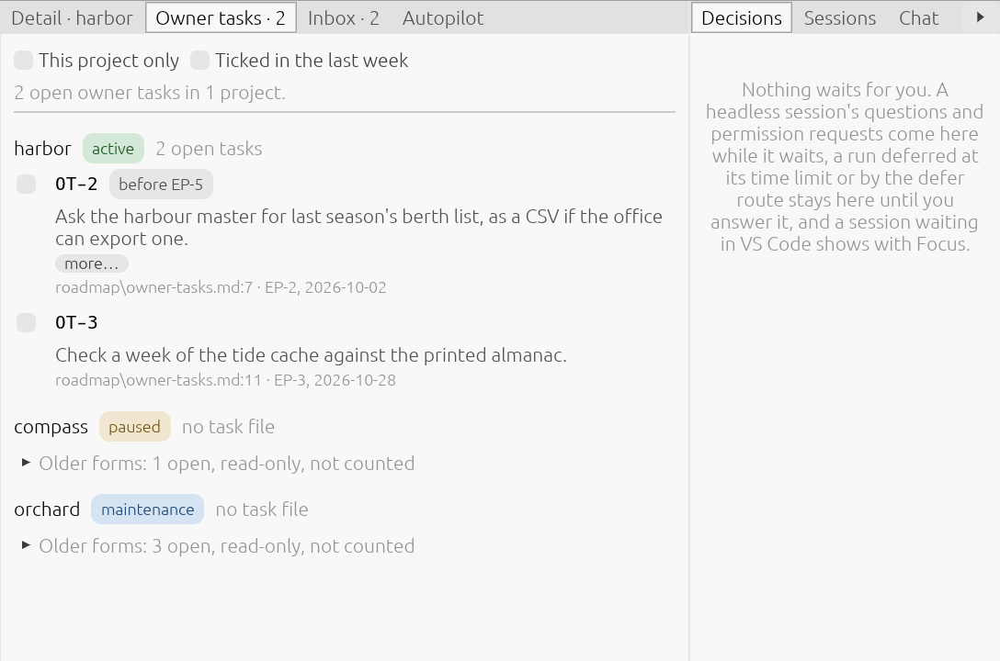
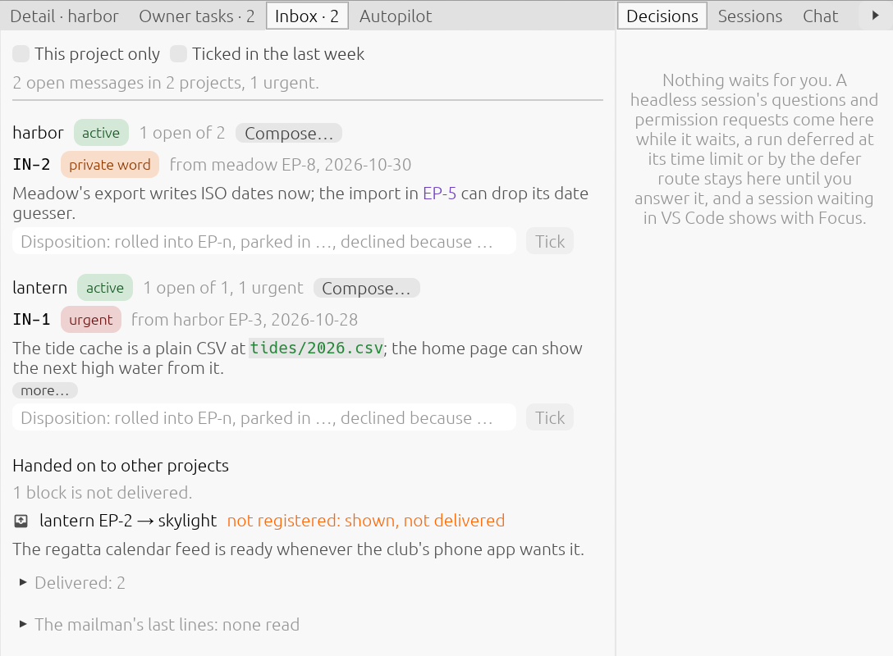
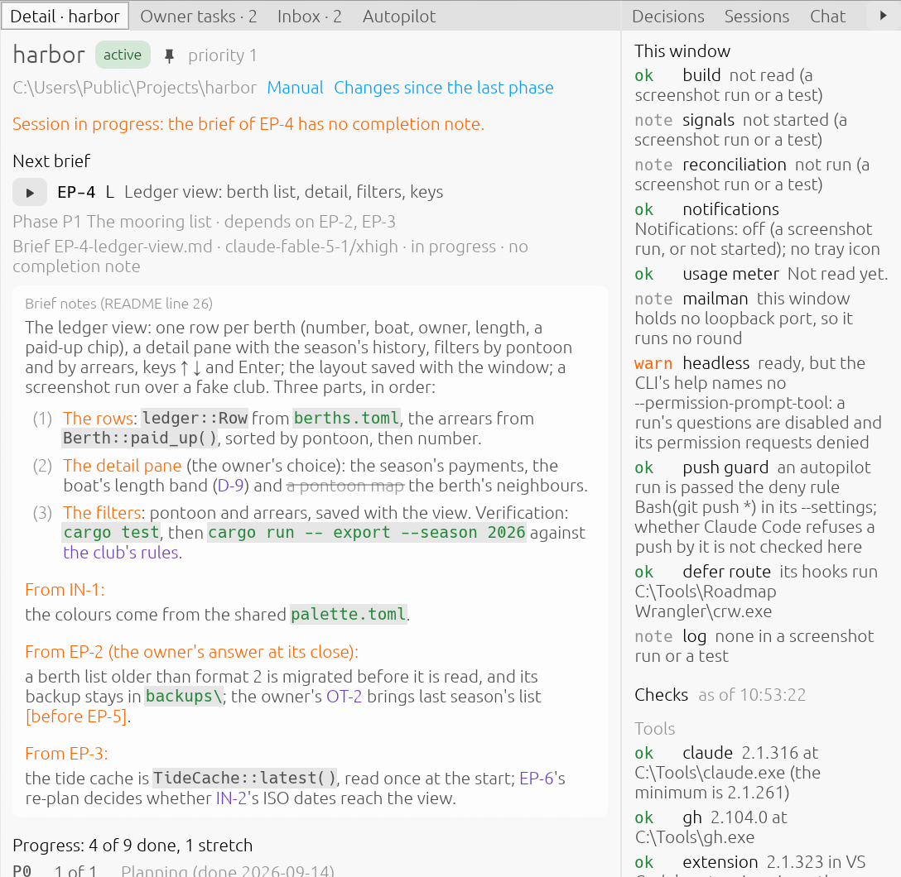
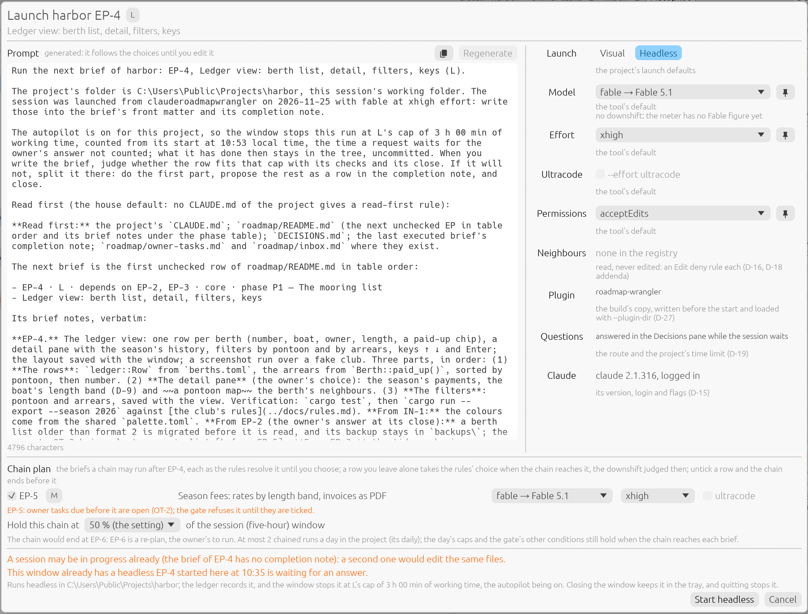
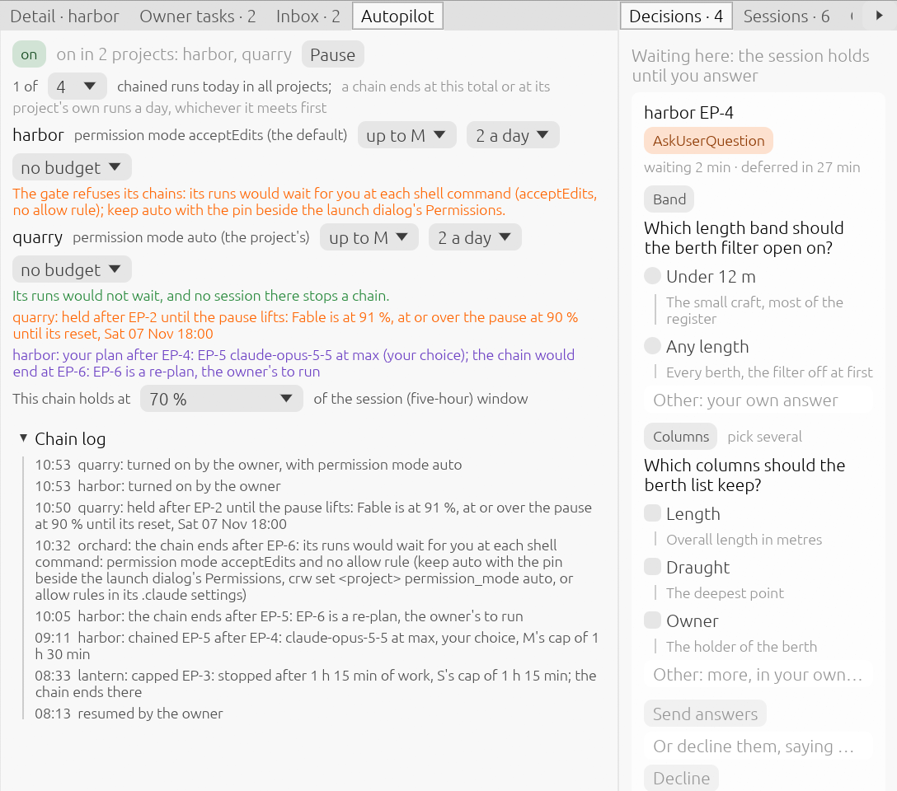
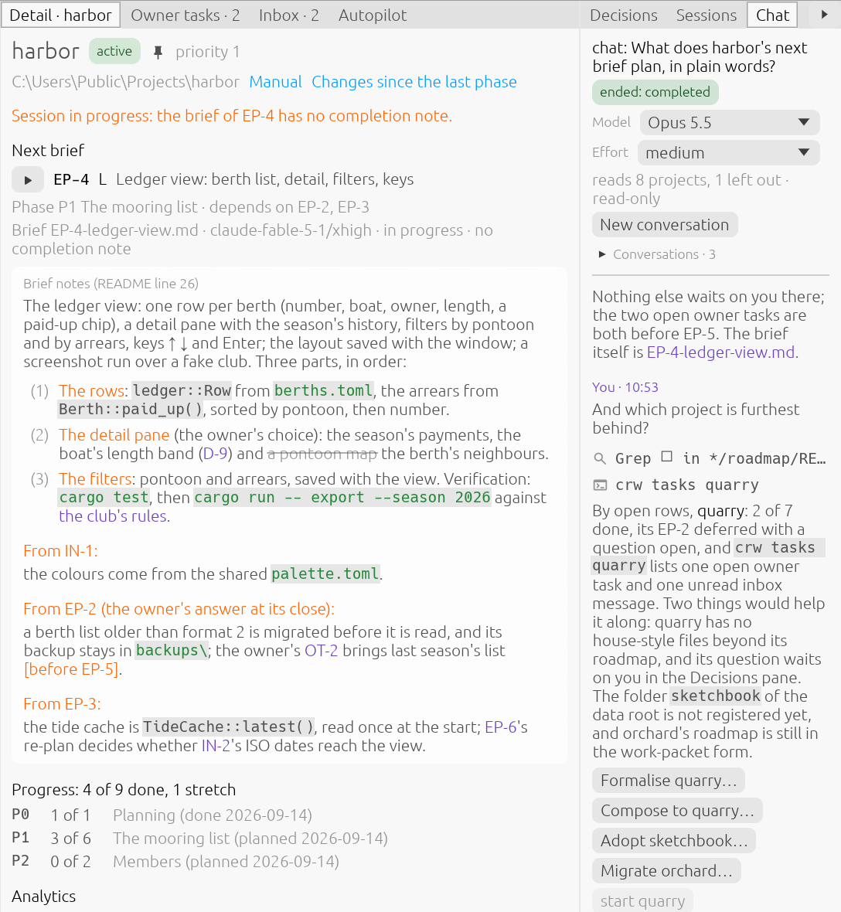
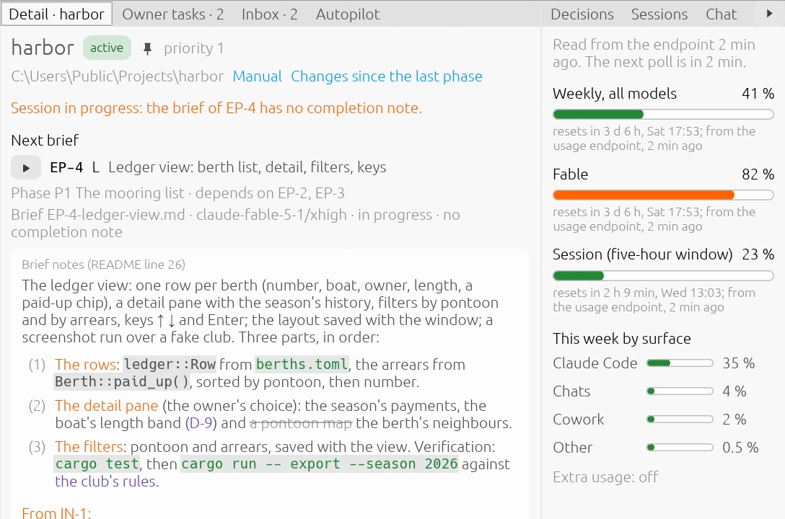

# Roadmap Wrangler — manual

Roadmap Wrangler (`clauderoadmapwrangler`) is a Windows desktop dashboard and session launcher
for one developer who builds a portfolio of software projects with Claude Code, each project
planned as a roadmap of session-sized briefs in the house style. One window shows every
project's next brief, starts sessions in VS Code or headless, answers what a headless session
asks, keeps the owner's tasks and the mail between projects, chains briefs on autopilot within
caps, meters the account's usage and serves a few pages to the owner's phone. This manual
describes the tool at phase P6's close (2026-11-27): the reference chapters first, then a
walkthrough of the routes no real use has met yet, which is also the script of the next walk.

The pictures show the fake portfolio the repository tracks for its screenshot runs, never real
projects. What changed since this manual was written is in `docs/manual-changes.md` until the
next re-plan folds it in.

## What it does

The tool keeps track of every project under one folder, the **data root**, and of the work
the owner and Claude Code do in them:

- **Projects and roadmaps.** Every folder directly under the data root is listed, and one
  registered in the tool's registry is a project, with a state (active, paused, maintenance,
  done, archived or unformalised). A project in the house style keeps `roadmap/README.md` with phase tables of
  briefs, a brief file per session, `DECISIONS.md`, `roadmap/owner-tasks.md` and
  `roadmap/inbox.md`; the tool reads them at git `HEAD` and in the working tree, and tells when a
  session is in progress.
- **Launching sessions.** The launch dialog writes the house-style opener for a project's next
  brief and picks its model, effort and permission mode by rules. **Visual** puts the prompt into
  a new Claude Code tab of the project's VS Code window; **Headless** runs the session inside the
  tool, its transcript in the Sessions pane.
- **Decisions.** A headless session's questions and permission requests wait in the Decisions
  pane for the owner's answer.
- **The autopilot.** A project's autopilot chains its next briefs after a headless run, once a
  gate passes: the brief done and committed, a clean tree, no owner task due, the caps of the day
  and of the account's usage. It is the owner's standing yes to that project's commits; pushes
  stay the owner's.
- **What waits on the owner.** Owner tasks (`OT-n`) and inbox messages (`IN-n`) of every
  project, ticked in their own panes; notifications in a popup, on the tray icon and, when set,
  on the phone through ntfy.
- **Mail between projects.** A brief's `Handed on (to <project>)` block is delivered into the
  receiving project's inbox once it is committed; the owner writes messages from the window.
- **The rest.** A chat with a read-only Claude Code session over the portfolio; the account's
  usage meter; each project's history and graphs; hosting and backup actions behind
  confirmations; exports; diagnostics; each project's manual built to PDF; a phone view over
  the owner's tailnet.

A few words recur throughout:

| Word | Meaning |
|---|---|
| Brief, EP | One session's work: a row `EP-n` of a phase table and its file `roadmap/EP-n-<slug>.md` |
| Size | S, about 30 minutes of active work, or M, about 45; L, about two hours, in older rows only |
| Next brief | The first unchecked row in table order, not the lowest number |
| Owner task | `- [ ] OT-n (EP-k, date) text` in `roadmap/owner-tasks.md`: what only the owner can do, optionally `before EP-m` |
| Inbox message | `- [ ] IN-n (from <sender>, date) text` in `roadmap/inbox.md`, optionally `[urgent]` |
| Ledger | The tool's own database of sessions, notifications, usage readings, mail and actions |
| Visual, headless, manual | A session the tool put into VS Code, one it runs itself, one started by hand elsewhere |

## Install and start

**What it needs.** Windows 11. To build: Rust 1.98 with the MSVC toolchain. For the features
that drive them: the Claude Code CLI, logged in (sessions, the chat, the usage meter); VS Code
with the Claude Code extension (Visual launches); the GitHub CLI `gh`, logged in (the hosting
badges and actions); Tailscale (the phone view); and the Typst CLI at exactly 0.15.1 (the
manuals). The tool drives your own Claude Code and login; it offers neither and never stores
the login's token.

**Build and install.** From the repository:

```powershell
cargo build --release                    # both exes, into target\release
pwsh -File scripts\install-shortcut.ps1  # rebuild, install, and refresh the shortcuts
```

The script runs `crw install`, which copies both exes into
`%LOCALAPPDATA%\clauderoadmapwrangler\bin` (each installed exe that differs from the build
renamed to a dated previous copy first, since Windows lets a running exe be renamed but not
replaced; an exe installed as built is left alone), writes the app's icon beside them and
refreshes `crw`'s copy on PATH; then it refreshes the desktop shortcut and the Start-menu entry
**Roadmap Wrangler**, which open the installed window. A release build therefore never meets the
running window or a hook.

**The restart into a new build.** After an install, `crw install` asks the window to restart into
the new build. The window does so at once unless something would be lost, such as a headless run
of its own that works or waits; a refused request is not remembered. Then **File > Install and
restart** (or the tray's item) does it later, its hover saying why not while it cannot, and the
status bar says a newer build waits; it also installs first a settled release build of the
repository that is newer than the installed copy. Between two runs of a chain the autopilot
takes the newer build itself, at the gate's moment, carrying the held chains and the chain plans
across the restart in a handover file. A chain that ends leaves the window as it is.

**The first start.** With no registry yet, the window starts from a default one: the data root
set to the folder that holds this repository, and this repository as the first project. It is
written to `%APPDATA%\clauderoadmapwrangler\registry.toml` at the first change made through the
tool (an Adopt, a state, a setting); the ledger lives in `%LOCALAPPDATA%\clauderoadmapwrangler`.
Every folder directly under the data root (dot folders aside) is listed, a plain folder marked
"A folder, not a repository", the new ones as unadopted, with **Adopt** and **Ignore**. Adopt
registers the folder (active when it is a repository with a roadmap, else unformalised), writes
its own `<folder>.code-workspace` beside it unless one is there, and adds it to the aggregate
workspace file. The window reads every project's files at once, then asks git one repository at a
time (the status bar counts "Asking git"), then GitHub through `gh` and each origin's head, daily
and on F5; nothing is ever fetched. A second window started by hand finds the first, asks it to
show itself and quits.

**Optional, once:**

- **File > Start at login, hidden in the tray** (or `crw autostart on`): Windows starts the
  installed window hidden in the tray when you sign in, so the ledger hears every session.
- `crw path on`: a copy of `crw.exe` in `%USERPROFILE%\.local\bin`, so `crw` runs from any shell;
  every install refreshes it.
- `crw signals install` (with `--inbox` to print a project's open inbox messages into each new
  session): Claude Code's hooks and status line in your user settings, after a dated copy of the
  file, so the window hears each session's start, waits, turns and end; `crw signals remove`
  takes them out.
- The roadmap-wrangler plugin in your own Claude Code sessions: the README's plugin section has
  the install commands; `claude plugin update roadmap-wrangler@clauderoadmapwrangler` takes what
  was pushed since. The tool's own headless runs load the installed build's copy of the plugin
  and need nothing.

**Trying it without your records.** Set `CRW_HOME` to a scratch folder: the registry, the ledger
and the backups then live there, and a hand-written scratch registry can point `data_root` at a
scratch data root with made-up projects.

## The window

The window is a set of ten docked panes: **Projects**, **Detail**, **Owner tasks**, **Inbox**,
**Autopilot**, **Decisions**, **Sessions**, **Chat**, **Usage** and **Diagnostics**. Drag a pane's
tab to another place to change the layout, which the window keeps; **View > Reset layout** puts
every pane back.


### Menus, keys and the tray

- **File:** Send a test notification (and the same in 10 seconds, to close the window to the tray
  first); Back up now…; Install and restart; Start at login, hidden in the tray; Close to the
  tray; Quit.
- **View:** the theme (System, Light, Dark); the density (Compact, Comfortable); Expand all and
  Collapse all; Cards; Reset layout.
- **The refresh button** beside the menus, or **F5**, reads every project again: the files, then
  git, GitHub and the origins.
- **Keys** while no text box has the focus: ↑ and ↓ select a row, → and ← expand or fold it,
  Enter opens the selection, **S** opens the launch dialog on the selected project's next brief,
  **A** turns its autopilot on or off.
- **The tray icon** counts what waits for you and marks what is new since the window was last in
  front. A left click shows the window. Its menu shows the counts, Show Roadmap Wrangler, a Start
  item for each pinned project's next brief, Pause autopilot (or Resume autopilot), Enable remote
  view… (or Disable), Install and restart and Quit Roadmap Wrangler.
- **Closing the window** leaves it in the tray with its headless sessions going on; Quit asks
  first when it would stop them.
- **The status bar** says what the window just did or refused (the notice; the keys' reminder
  while there is none), how far the reading has come, the usage strip, a chip when a newer build
  is installed, and "Up to date". The menu bar's right end counts the projects, the unadopted
  folders, the open owner tasks and the open inbox messages. The chip also shows when a settled
  release build of the repository is newer than the installed copy, which File > Install and
  restart then installs first.

### Projects

The registry's projects grouped by state, pinned ones first, each row in columns as wide as their
widest value under a header row: the expander and the pin, then **Project**, **State** (a bulb
marks a proposed change of state), **Next** (the next brief's id and size; its one-line summary
on the id's hover), **Done** (rows done of all rows), **Waiting** (open owner tasks and open
inbox messages; a project without `owner-tasks.md` shows a small mark for its older forms,
counted nowhere), the badges: **Stack**, **Hosting**, **Sync** (the clone against its origin),
**Age** (the last commit's age, a dot for a dirty tree), **CI** (the latest GitHub Actions run; a
gavel for a public repository without a license), **Backup**, **Usage** (this week's share of the
usage in points of the weekly limit), then **Session** (a session in progress) and, at the row's
right end, the autopilot box and the Start button. As the window narrows, the optional columns
give way.

The toolbar holds **Filter by name**; **Sort** (priority, completion, remaining, last activity,
hosting, usage share, name); **Filters** (by stack and by hosting); **Legend**, a key to every
mark under the list; Expand all and Collapse all, which open or fold every row inline (its phases
and a burn-up sparkline); and **Cards**, the same groups as cards. A click selects a row, its
Start button opens the launch dialog, its box turns its autopilot on or off; a right click opens
its menu:

- **Pin** or **Unpin**; **Priority** (1 the highest to 5); **State**.
- **Refresh this project**: its files, git and history read again, the other rows left alone.
- **Manual** and **Changes since the last phase** (see "The manuals").
- **Dismiss:** and the proposal's reason, one item per open proposal: leaves that proposed state
  out until the fact it rests on changes.
- **Send a message…**: a message from you into the project's inbox.
- **Formalise…** and **Migrate the roadmap…**, for a project that lacks the house-style files or
  keeps an older roadmap.
- The hosting actions its remote allows (see "Hosting and backup").
- **Revert the latest session…**, behind a preview.

A project is read again by itself when a session there ends, at once and said in the status bar;
and, at most once in five seconds and quietly, with a line in the rolling log alone, when a
visual or manual session there ends a turn, when its `roadmap` folder changes, or when its git
`HEAD` moves (a commit made in a terminal too).

### Detail

The selected project: its name and, on the line under it, its path with the **Manual** and
**Changes since the last phase** links; the next brief's notes set for reading (each `From …:`
segment under its label, numbered parts as a list, labels, references and code in their own
colours); its phases and progress; **History** (each EP's date as git and the briefs settle it,
the flagged ones where they disagree, Re-import, and a fold of the dated EPs with each completion
note's model, effort and duration); **Analytics** (the graphs); and **Status**, its subsections
Stack, Activity, Hosting, Health (CI and the license), Backup (with Back up now), Usage (the
week's share) and **Manual** (the manual's date beside the last phase's close). Then a line on the
project's owner tasks with **Open in Owner tasks**, and one on its mail with **Open in Inbox** and
**Compose…**. Last, under headers that fold as you leave them: the decision
log, **House style** (what Formalise… would write, when that matters) and **Problems** (what the
parser could not read), open while there are any.

### Owner tasks



Every project's open owner tasks in one place, grouped by project in the list's order, each with
a box that ticks it in the project's `roadmap/owner-tasks.md` (the file copied to the backups
folder first; nothing else in the project changes). A gate `before EP-m` shows as a chip beside
the id, amber when it holds the project's next brief, which the autopilot then will not chain
into. A long task shows one sentence to a bullet; one longer than about six lines shows its first
sentence and "more…". The two switches, **This project only** and **Ticked in the last week**,
show the selected project alone and the tasks the tool ticked in the last week (from this pane,
the Detail pane, the phone or `crw tick`; a tick written into the file by hand is dated nowhere,
so it is not shown), with **Untick**. At each project's foot its older forms (a risks list, parked blocks, open questions)
lie folded, read-only and counted nowhere.

### Inbox



Every project's open inbox messages, grouped by receiver in the list's order, each ticked there
with a disposition (written on its line as `**Disposition (date):** …`), and **Compose…** beside
each receiver's name. Under them: the blocks the briefs hand on (those that wait or name an
unknown receiver shown, the rest folded) and the mailman's last lines. The two switches, **This
project only** and **Ticked in the last week**, show the selected project alone, with every
message it ever ticked folded, and the messages ticked in the last week. A message whose sender, text or disposition holds one of your private words (the
`private_words` setting) is flagged in amber, "private word", when its project's remote is public
or of unknown visibility, so that you reword it before a commit carries it; the word itself is
never shown.

### Autopilot

The autopilot's state with **Pause**, the day's chained runs in all projects against the total a
day (a picker beside it sets the total), a line per project whose autopilot is on (its permission
mode, what the gate would refuse it for between runs, and its limits as pickers: the largest
brief, the runs a day and a budget a run), the held chains, the chain plans in hand, and last the
chain log, folded under its header with its newest line beside it. The chapter "The autopilot and
its gate" tells how it decides.

### Decisions, Sessions, Chat and Usage

- **Decisions:** what headless sessions ask while they wait (the chapter "Answering a session").
- **Sessions:** a tab per headless run of the window's with its transcript as it streams, and the
  **All** tab: every session, the window's, those Claude Code reports elsewhere and the ledger's
  latest rows, filtered by project, mode and running only, with a line on the autopilot's state
  and Open in Autopilot.
- **Chat:** the read-only Claude Code session over the portfolio (the chapter "The chat").
- **Usage:** the account's limits with their resets (the chapter "The usage meter").


A run's tab has, while it runs, **Stop** (interrupts the turn and closes its input, the job
killed if it has not exited within 30 seconds) and a red cross that kills it at once, each ending
its whole process tree; once it has ended, **Dismiss** (closes the tab; the ledger keeps its
rows), **Resume** (runs it again under its session id with the message typed there),
**Revert…**, and **Commit** when it stopped before committing because its project's autopilot
was off. A ledger card of a visual or manual session
has **Resume in VS Code**, which opens the conversation in a tab of the project's window; a
headless run's card names its id for `claude --resume <id>` in a terminal. The transcript stays in
the window's memory: the tool writes none and reads none.

### Diagnostics



The same checks as `crw doctor`, gathered on a worker thread when the pane is first shown and at
**Check again**: the window's own lines (its build, the signals, the notifications, the meter,
the mailman, the headless route, the log), then the tools' versions (Claude Code against its
minimum, Typst against its pin, the extension, `gh`, Tailscale, VS Code), this exe, the installed
copy and the plugin's, each hook and the status line and the exe it runs, `gh`'s login,
Tailscale's state and the remote view's line (with Enable or Disable remote view under Network),
the backup drive, the registry and the ledger, the crash log, the rolling log, the last readings,
and VS Code's lock files (counted, never deleted). Each line is ok, a note, a warning or a
failure, and nothing is changed.

## Launching a session

**S**, a row's Start button, or a pinned project's Start in the tray opens the **launch dialog**
on the project's next brief. The dialog reads the project again as it opens; when the row's brief
was done meanwhile, it drafts the next one and says so in its first line.



- **The prompt**, the house-style opener for the brief, in an editor: it follows your choices
  until you edit it, **Regenerate** writes it again, and the copy button takes it to the
  clipboard.
- **Launch**, Visual or Headless, the project's default first (`[project.launch] mode` in the
  registry).
- **Model**, **Effort**, **Ultracode** and **Permissions**, each with the reason the rules gave
  it. The model list is the catalog Claude Code caches.
- **Neighbours** (the folders a headless run reads but never edits), **Plugin** (the build's copy
  it loads), **Questions** (where they are answered, and the project's time limit) and
  **Claude** (the CLI's version and login).
- **The pins** beside Model and Effort keep the value shown as a rule the tool writes and names,
  **Keep … for this project** or **Keep … for phase Pn**, or take it back to the rules; the pin
  beside Permissions keeps the mode as the project's `permission_mode`, or takes it back to the
  default (acceptEdits). `crw set <project> model|effort|permission_mode <value|default>` does the
  same for the whole project.
- **The Fable downshift**: while the meter's Fable figure is above `fable_downshift_percent` (60 %
  by default), a brief that would run on Fable is proposed Opus 5.5 at the same effort, and the
  dialog says how it judged the figure. While the session (five-hour) figure is at or over the
  autopilot's mark, it says a run started now may hit that limit.
- **The chain plan**, for a project whose autopilot is on: the briefs a chain may run after this
  one, each with a Chain box and its own Model and Effort, and the chain's own five-hour mark.
- **A newer build installed**: a line and its own **Install and restart**, which closes the
  dialog, restarts the window into the new build and opens the dialog again there.

**Visual** (Open in VS Code) opens the project's own workspace file, which brings its VS Code
window to the front or opens it, and fills the prompt into a new Claude Code tab, where you choose
the model and effort and send it: the link carries the prompt alone, so the dialog's model,
effort, ultracode and permission pickers are greyed with their pins, the Neighbours, Plugin and
Questions lines say they are Headless only, a **VS Code** line takes the Claude line's place, and
the opener names the rules' suggestion.

**Headless** (Start headless) runs the session inside the window with the chosen settings and
gives it a tab in the Sessions pane. The project's neighbour folders are passed read-only, the
plugin's copy is loaded, `ANTHROPIC_API_KEY` is removed from its environment, and its questions
come to the Decisions pane. While its project's autopilot is on, it has a cap by size, the
project's budget a run and the deny rule against `git push`, and the gate weighs its end (next
chapters).

**The rules.** A project's `[project.launch]` table in the registry sets its defaults and may set
a prompt `template`; `[[rule]]` tables, global or per project, match a brief by size, phase or
title words and set its model, effort, an effort step or ultracode. Within each table every rule
that matches applies, the earliest one winning for each value it sets; the project's rules apply
after the global ones and so override them. While the registry has no global rule, a built-in
one stands in: an S brief one effort step lower. `crw prompt <project>` prints what a launch
would start from, with the reasons, and launches nothing.

**Reverting a session.** Each session's start is recorded: the project's `HEAD`, its branch and a
copy of its uncommitted files, kept in the backups folder. **Revert…** (from an ended session's
tab, a ledger card of the Sessions pane, or a row's Revert the latest session…) previews putting
the project back as it was at that start: each commit and file it undoes and what stays. Revert
copies the session's work out first, then resets; it never pushes, and it is refused while a
session works there or when the remote has one of the session's commits. `crw revert` previews
and, with `--yes`, does the same.

## Answering a session

The **Decisions** pane holds what headless sessions ask while they wait:

- **A permission request**: its tool, its call, why it asks and its input, with **Allow** or
  **Deny** and an optional reason.
- **A question**: its options, one or several, or your own words; **Send answers**, or
  **Decline** with a reason typed first.

The pane sits at the window's right in the default layout: the picture in the next chapter shows
it there with a session's two questions, one answered by a single choice and one by several, each
with its own words as the last option, then Send answers or Decline.

A project's `answer_timeout` (`crw set <project> answer_timeout <minutes|none>`, none by default)
defers a run whose request waits that long: the request is refused, the turn ends, and the answer
you give later in the pane resumes the session with it (the buttons then read **Allow and
resume**, **Deny and resume**, **Answer and resume** and **Decline and resume**). With `crw setting decisions defer` (or by
itself, for a CLI that refused the control protocol's handshake) the window takes Claude Code's
defer-and-resume route instead: a hook ends the run at each question, and your answer resumes the
session. A session Claude Code reports waiting elsewhere is listed too, never answered: **Focus**
brings its VS Code window forward. The ledger keeps how many questions a run asked and how long
the answers took.

## The autopilot and its gate



**Turning it on.** A project's box in the list (or **A**) turns its autopilot on: the owner's
standing yes to that project's commits. Its headless sessions then commit in the house pattern
(or the project's own, when its `CLAUDE.md` states one), record the hash in the roadmap and never
push; every such run also gets a deny rule against `git push`. With it off, a headless session
stops before committing and its ended tab offers **Commit**, which resumes it with that yes.
Ticking the box of a project whose runs would wait at each shell command offers the permission
mode `auto` first, with what it means.

**The gate.** When a headless run of such a project completes, the gate reads the project afresh
and chains the next brief only if all of these hold, naming each that fails:

1. The brief has its completion note and its checked row, and is committed.
2. The next brief is not a re-plan and no larger than the project's largest (M by default).
3. No owner task is due before it (`before EP-m`).
4. The tree is clean (an inbox changed by the tool's own delivery or your message during the run
   is allowed).
5. The day's caps: the project's chained runs a day (2 by default, `crw set <project> daily`)
   and the total in all projects (4 by default, `autopilot_daily_total`).
6. The weekly and Fable figures under `autopilot_pause_percent` (90 % by default) and recent
   enough to trust; the session (five-hour) figure under `autopilot_five_hour_percent` (50 % by
   default) or the chain's own mark from its plan.
7. No other session works or waits there (an idle tab is named, not counted).
8. Its runs would not wait at every shell command (the permission mode `auto`, or allow rules).

If only your Pause, a mark, or a usage figure too old to trust refuses, the chain is **held**
until that lifts. If the gate passes, the next brief starts headless as the chain plan says: the
model and effort you set, the rules' way where you left a row alone, and the chain ends before a
brief you unticked.

**The cap.** Every headless run of a project whose autopilot is on (your Start headless, the
phone's start and the chain's alike) has a cap by size, counted in working time with a question's
wait left out: S 75 minutes, M 90, L 3 hours, and L's for a row without a size; a migration has
none. At the cap the run is stopped gracefully and what it did stays in the tree, uncommitted. Its
opener says the cap and when it started, and asks the session to split a row that will not fit
when it writes the brief.

**Pause** (the Autopilot pane, the tray, or `crw autopilot pause`) holds every chain; the runs
that work go on. Each change of a chain's state (a brief chained, a hold, an end) is a
notification of its own, whose Show opens the Autopilot pane; `crw autopilot` prints the state and
the chain log. This repository chains like any other: its briefs end with the install, and the
window restarts into each brief's build before the next.

## Notifications

The window calls you with a **popup** of its own at the screen's lower right: always on top,
taking no keyboard focus, with no taskbar button, so it works while Windows' toasts are off. A
notification comes when a session waits for an answer or a permission (a headless run of the
window's, a deferred run, or a session waiting in VS Code or a terminal), when a run finishes
(with the first sentence of its result) or fails, when a session elsewhere ends a turn of two
minutes' work or more, when a chain changes state, when the weekly or Fable limit passes 80 % and
95 %, and when a message flagged `[urgent]` arrives in an inbox from anyone but you. Each has
**Show**, which brings the window forward on the pane that matters (or the VS Code window a
session waits in), and **Dismiss**, and the popup has **Dismiss all**; each stays until shown or
dismissed.

- **Quiet hours** (`crw setting quiet_hours 22:00-07:00`, none by default) hold notifications
  back; so does the window being in front, where the status bar says them instead.
- **ntfy**: with `crw setting ntfy_host <server>` and `crw setting ntfy_topic <topic>`, each
  notification the popup shows is pushed to that ntfy server for the phone (`https://` unless the
  host is written `http://`; urgent messages at ntfy's urgent priority, waits, failures and usage
  marks at high). When the ntfy server runs on this PC, its loopback address
  (`http://127.0.0.1:<port>`) is the safest host, since a VPN on the PC can hide the server's
  private-network name from the PC itself.
- **File > Send a test notification** puts one in the popup (and pushes it).
- `crw notifications` prints each notification and what became of it, each Show and each badge.

## Mail between projects

**Handed-on blocks.** A brief that has something for another project writes, after its completion
note, a `> **Handed on (to <project>).** …` block. The window, as the mailman, appends it to that
project's `roadmap/inbox.md` as a new `IN-n` line once the block's words are committed (the
brief's copy at `HEAD` holds them), while no session works or waits in the receiver; an idle tab
does not hold the mail. The status bar says so, the receiving row shows the message, and the
Inbox pane says what became of each block. A block reworded and committed again is sent again,
saying which message it rewords. `crw mail` prints the mailman's log; a revert of a session in
the receiving project puts the message back.

**Your own messages.** **Compose…** (in the Inbox pane and on the Detail pane's mail line), a
row's **Send a message…**, or `crw send <project> <words> [--urgent]` writes
`IN-n (from the owner, <date>)` into the project's inbox at once, even while a session works
there (the dialog says so: the next session triages it), with `[urgent]` at its end when flagged.
Compose creates a missing `roadmap/inbox.md`, so a project need not be formalised first.

**Triage.** A project's next session reads its open messages after the roadmap and, for each,
rolls it into its brief, parks it in a later brief's notes, proposes a new row, or declines it,
writing the disposition on the line. You may tick a message yourself in the Inbox pane with a
disposition, or with `crw tick <project> IN-n <disposition>`.

## Formalise and migrate

**Formalise…** (a row's menu, or the Detail pane's House style section) gives a project the
house-style files it lacks, behind a preview of each file and its change:

- a rule block in its `CLAUDE.md` between `<!-- roadmap-wrangler:begin -->` and
  `<!-- roadmap-wrangler:end -->` (the text outside the markers is never touched, and the file is
  copied to the backups folder first);
- `roadmap/owner-tasks.md` and `roadmap/inbox.md` with their headers;
- the brief template `roadmap/_TEMPLATE.md`.

A file that is there is never replaced. **Write** reads the files again and writes only the plan
shown, refused while a session works or waits there. `crw formalise <project>` previews the same
and `--yes` writes it. A revert of a session that started before a formalise writes the
house-style files again after the reset.

**Migrate the roadmap…**, for a roadmap in one of the two older shapes the tool reads (a
five-column table, or work packets), opens the launch dialog in Headless with a migration prompt
in place of the opener: the session converts the tables to the house form, keeping every id,
hash and file, puts its plan to you and stops before committing. The run is labelled
`migration`, no chain follows it, and its commit is yours. `crw formalise <project> --migration`
prints the prompt.

The plugin's `/roadmap-wrangler:formalise` skill does the same from a session inside a project:
it runs `crw formalise` for the preview and `--yes` on your word, naming the project by its
registered name, by `.` or by its path, which all read the same project (see "The crw
commands"); `crw path on` puts `crw` on PATH for it.

## The chat

The **Chat** pane hosts a read-only Claude Code session over the portfolio. Each message is a
turn of one session, kept in the ledger (`crw chats` lists the conversations), with a digest of
every project's standing in its system prompt. The session is confined to the projects' folders,
a project marked as a data repository (`crw set <project> data yes`) is never given to it, and it
writes nothing.



- Replies draw as Markdown. Each conversation has its own model and effort; **New conversation**
  starts another, and the ledger's conversations are listed under the header's **Conversations**
  fold and picked up again.
- The session's own questions are answered in the pane, with the Decisions form.
- A reply may offer **actions** as buttons that open the window's own dialogs with the project
  filled in (Adopt, which asks first whether the folder is a data repository, Formalise…,
  Migrate…, Compose… with the words typed); nothing is written before your click there. A line it
  proposes outside these four is shown greyed and does nothing.
- The session runs `crw`'s reading commands under exact permission rules, and an `@<project>` in
  a message gives it that project's context.
- **Enter** sends and **Shift+Enter** starts a new line. A message sent before `claude` has
  answered the checks asked before each session (its version, login and flags, kept an hour),
  while another session starts, or while the conversation's reply still runs, waits in the box
  with **Cancel** and goes by itself.

## The usage meter

The meter reads the account's limits from Claude Code's usage endpoint every 5 minutes, soon after
a session the tool launched ends, and with a backoff while it fails. Each poll reads the login's
token from Claude Code's credentials file at that moment and sends it to `api.anthropic.com`
alone; the token is never written, logged or shown. The endpoint is undocumented and treated as
breakable.



- **The status bar** shows the weekly limit, the Fable-scoped one and the session (five-hour)
  window while one is open, each a small bar with its percent, amber from 80 % and red from 95 %.
- **The Usage pane** shows each limit with its reset countdown, the week's use by surface and
  extra usage; a quiet line while no five-hour window is open.
- When the endpoint fails, the meter shows the newest of the endpoint's last reading and Claude
  Code's status lines, marked degraded with the reason; `crw setting usage_endpoint off` keeps it
  on the status lines.
- Each poll's rise is split among the sessions that worked since the poll before, so each
  session's ledger row keeps its share; each project's sum since the weekly reset is its Usage
  badge (`+6 %`), and the Usage share sort ranks by it.
- `crw usage` prints the readings and the meter's changes of state.

## History, analytics and exports

**History.** Each project's history is imported from its git log and its briefs' completion notes:
the commits that record an EP date it, the note cross-checks the date and wins when the two
differ by more than a day, flagged. The Detail pane's History section shows the dates, the
flagged EPs and **Re-import**; `crw history <project>` prints the same. The ledger keeps each
project's done and total counts once a day.

**Analytics.** The Detail pane draws a calendar heatmap of the last 16 weeks (sessions per day, a
dot for a day with a completion), a burn-up of done and total by day (a re-plan is a jump), the EPs
completed per week over the last 8, and a projection: the open rows by size at the measured median
per size, and the finish as a range. The list's rows expand to a burn-up sparkline, and the cards
carry it too.

**Exports.**

- **The daily export**: once a day, at the window's first read of the day and when the day turns
  while it is up, a copy of the registry (`registry.toml`) and every table of the ledger
  (`ledger.json`) into this repository's git-ignored `private/export/<date>/`, keeping the last 14
  days and each month's first folder (`crw export daily` writes it at once).
- `crw export csv <project>` writes a project's sessions and daily counts as CSV there.
- `crw export site` previews `projects.json`, the cards of the projects whose remote is public,
  and `--yes` writes it into the `assets/data` folder of the project the `site` setting names,
  whose page reads it; the tool never edits the page and never pushes. The snippet
  `projects-cards.html` is no longer written, and a copy an older export wrote stays where it is.

**A data repository's site card** comes from a file the repository writes itself, outside its
folder: `cards\<registered name>.json` in the tool's local folder,
`%LOCALAPPDATA%\clauderoadmapwrangler` (under `CRW_HOME` in a trial). The tool still reads nothing
inside a data repository and starts nothing there.

- **The file** is JSON in UTF-8 with `as_of` (the day it was written, `YYYY-MM-DD`) and the card's
  fields: `name` (the registered name), `badge` (the stack's text), `done`, `total`, `percent`
  (done of total, rounded down) and `next`, the first undone rows in table order, at most two,
  each with `id`, `title` and `size` (`S`, `M`, `L` or null). Other fields are ignored.
- **Public** is the account's list the window caches: the card is carried only when the list holds
  a public repository by the project's registered name or its folder's name; otherwise the file is
  not even opened.
- **The preview** prints the cards' folder and, for a data repository, either its card, marked
  "its own card of" with its day, or why it is left out: not public, no card file, a file that
  does not read, or
  one that is malformed (another name, a day badly written or after today, counts that do not add
  up, a wrong number of next rows, a size other than S, M, L or null). A card is never left out for
  its age: the repository rewrites it whenever its figures change.

## Hosting and backup

A row's menu and its Detail pane offer what its hosting allows:

- **Create a private remote**: `gh repo create … --private --source … --push`.
- **Make public** or **Make private**: `gh repo edit --visibility …`, the dialog repeating `gh`'s
  consequences and, for Make public, what a push to a public remote means. Before Make public's
  confirmation the dialog reads the project's whole history once, every commit's message, paths
  and added lines, against the words of `crw setting private_words <file>` (one fixed string a
  line), lists the commits that hit by short hash and subject, never the word, and asks for a
  second tick when any did or the history did not read.
- **Remove the remote**: `git remote remove origin`, GitHub left alone.
- **Archive the orphan…** and **Delete the orphan…** for an orphan (a project here with no remote
  whose name your GitHub account also holds; the action is on that GitHub repository); Delete is
  refused until `gh`'s token has the `delete_repo` scope.
- **Back up now** (the Backup subsection, and File): the backup job's script run with `-Force`.
  The Backup badge reads the existing job's settings file and run log, named by the
  `backup_settings` and `backup_log` settings.

Each opens a dialog that names the command, reads the plan again at the press and runs it only if
it is the plan shown; never while a session works or waits in the project, and never for a project
marked a data repository where it would put it on GitHub or make it public. Each run is a line in
the ledger, a failure is shown in the tool's own words and never retried, and the project's
readings are asked again after it. `crw act <project> <action>` and `crw act backup` preview the
same plans and run nothing.

## The manuals

A project the owner calls working well enough to owe a manual keeps `docs/manual.md`; the file's
presence is the mark. Beside it, `docs/manual-changes.md` holds what changed for a user since the
last phase's close: each brief that changes what a user sees or does adds a section, and the
phase's re-plan folds them into the manual and empties the file. The manual's pictures sit in
`docs/`.

**The PDFs** are built on demand and never tracked. `crw manual <project>` turns `docs/manual.md`
into Typst markup inside one template (a title page with the manual's title and opening
paragraphs, a contents page, numbered chapters each on a new page, page numbers) and runs the
Typst CLI, so the same source gives the same bytes, offline, into
`%LOCALAPPDATA%\clauderoadmapwrangler\manuals\<project>-manual.pdf`; `--changes` builds the changes
file into `<project>-manual-changes.pdf`, its sections flowing on. A PDF newer than its source,
its pictures and `crw` itself is left alone unless `--force`. Raw HTML and a picture outside
`docs` are left out with a warning naming the line; footnotes and task-list boxes are not drawn;
a link to a file or an anchor keeps only its text, and a web or mail address stays a link.

**Typst** is pinned at 0.15.1, and `crw manual` refuses another version:

```powershell
winget install --id Typst.Typst --version 0.15.1
winget pin add --id Typst.Typst --version 0.15.1
```

**In the window.** **Manual** and **Changes since the last phase** sit on a row's right-click menu
(after Refresh this project) and as two links beside the path at the Detail pane's head. Each
builds the PDF when it is stale, on a worker thread, and hands it to your PDF viewer through
Explorer; the status bar says what was built or why not, and the converter's warnings go to the
rolling log. An entry is greyed, its reason on hover, when the project owes no manual (no
`docs/manual.md`), the changes file is missing, Typst is not found (install it, then press F5),
or a build is on its way. The Detail pane's Status section ends with the **Manual** line: the
manual's date (its last commit while the file is as committed, else the file's own time) beside
the last phase's close, amber when that phase closed after the manual's date, since its changes
are then not folded in.

## The phone view

The window's loopback server answers a few pages under `/m/` for the phone:

- **The list**: the usage strip (the weekly, Fable and session figures with their resets), the
  autopilot's block (Pause or Resume, the day's chained runs, the held chains, the plans and the
  chain log's latest lines), then each project's next brief, progress, waiting items, sessions
  and badges in words.
- **A project's page**: its next brief's note, its owner tasks, its inbox and its sessions; tick
  an owner task, tick a message with its disposition, write a message, stop a headless run of the
  window's there, and a page that starts its next brief headless with the model and effort the
  rules resolve, after showing what the run would be and what refuses it now.
- **The decisions page** answers headless sessions' questions and permission requests, a deferred
  run's too.
- **The sessions page** and **a run's own page**, its transcript as it comes in, with its waiting
  questions and Stop; a message, Resume, Kill, Revert and Commit stay the window's.
- **The notifications page** and **the doctor's page**, with a Check again of its own.

Each form goes to the window, which runs it as the desk would, says what came of it on the page,
in its status bar and in its log, and takes it while hidden in the tray too. One small script of
the tool's own fetches the parts of a page that changed; the pages work without it.

**Enable remote view** (the tray, or the Diagnostics pane's Network group) puts the pages, and
nothing else of the window, on your tailnet through Tailscale Serve:
`tailscale serve --bg --https=9443 --set-path=/m http://127.0.0.1:<port>/m`. The confirmation
names the command, checks the tailnet first (refusing a tagged device, a missing HTTPS
certificate, a port or path held by another service, Funnel on that port, or Serve already passing
the window's port elsewhere), shows your Tailscale login, which it writes to the registry's
`owner_login`, and shows the link with **Copy** and **Send the link to my phone** (through ntfy).
**Disable remote view** runs `tailscale serve --https=9443 --set-path=/m off`.

**The guards.** A request through Serve must carry the login `owner_login` names and name this
machine's tailnet name or the loopback as its host; a form must come from the page's own origin;
the pages load nothing from elsewhere and forbid caching and framing; the phone's actions are
tick, answer, compose, start, stop, pause and check again, nothing more (no revert, no kill, no
hosting action, no free text into a session). Each action through Serve is a line in the ledger,
and each refusal too, at most once a minute for each identity; `crw remote` prints them. Disable,
or removing the phone from the tailnet, ends the access. A phone running another VPN beside
Tailscale may lose the tailnet while that VPN is up.

## The crw commands

`crw` is the command-line twin of the window: `crw help` prints every command with its words.
Run from any shell once `crw path on` has put it on PATH, else as `target\release\crw.exe`. The
commands that only read can run at any time, the window up or not.

**A project or a folder.** A command written below with `<project|folder>` reads its argument in
one order, from any folder:

- **A word alone** (no `/` or `\`, not `.` or `..`, no drive) is a registered project's name
  first. A file or a folder of that name in the working directory is read only when no project is
  registered under it. When both exist, as in a project laid out as `<name>\<name>`, the project
  is read and a `note:` line names the folder passed over. To read that folder instead, write
  `.\<name>`.
- **A path** (`.`, `..`, a separator or a drive) reads that place. A folder that a project is
  registered in reads as that project, with its name and state, so `crw status .` from a
  project's root shows its registered name and state, and `crw send .` and `crw tick .` log the
  registered name.
- **A file** is still read as a brief (by its name) or a README by `crw roadmap`.

`crw revert` reads its argument the same way and needs a registered project; `crw help` says the
order under the commands.

**Install and environment**

- `crw install [--no-restart]`: copy the release build into the install folder and ask the window
  to restart into it.
- `crw autostart [on|off]` and `crw path [on|off]`: the start at login, and the copy on PATH.
- `crw doctor`: the Diagnostics pane's checks, then whether a headless session would start and
  whether a chained run's launch keeps the `git push` deny rule. Reads only.
- `crw signals [status|install|remove]`: the hooks and the status line in Claude Code's user
  settings. `crw hook` and `crw statusline` are the relays those run.

**Registry and projects**

- `crw scan`: the registry's projects, the unadopted folders and the proposals.
- `crw adopt <folder>…` and `crw ignore <folder>…`.
- `crw set <project> <key> <value>`: `state`, `priority`, `pinned`, `answer_timeout`, `revert`,
  `data`, `permission_mode`, `max_size`, `daily`, `max_budget_usd`, `model`, `effort`.
- `crw dismiss` and `crw undismiss <project> [<proposal>]`.
- `crw setting [<key> [<value>]]`: the registry's settings (`data_root`, `backup_settings`,
  `backup_log`, `port`, `decisions`, `quiet_hours`, `usage_endpoint`, `fable_downshift_percent`,
  the autopilot's marks and daily total, `autopilot_paused`, `ntfy_host`, `ntfy_topic`, `site`,
  `private_words`, `owner_login` and the rest).

**Roadmaps and what waits**

- `crw roadmap <project|folder>`: what the parser reads (a brief or a README file too).
- `crw tasks <project|folder>`: owner tasks, inbox, handed-on blocks and older forms.
- `crw tick <project|folder> OT-n`, `crw untick <project|folder> OT-n`,
  `crw tick <project|folder> IN-n <disposition>`.
- `crw send <project|folder> <words…> [--urgent]`.
- `crw formalise <project|folder> [--yes|--migration]`.
- `crw manual <project|folder> [--changes] [--force]`.
- `crw history <project|folder> [--reimport]`.
- `crw status [--offline] [<project|folder>]`: the badges.
- `crw prompt <project|folder> [--visual|--headless]`: what a launch would start from.

**Sessions, autopilot and logs** (all read only, except where a verb says otherwise)

- `crw sessions [<project>] [--all]` and `crw chats [--all]`.
- `crw revert <project> [<id>] [--yes]`.
- `crw autopilot`, `crw autopilot <project> on|off`, `crw autopilot pause|resume`.
- `crw usage`, `crw notifications [--all]`, `crw mail [--all]`, `crw remote [--all]`.

**Hosting and exports**

- `crw act <project> <action>` and `crw act backup`: previews only.
- `crw export site [--yes]`, `crw export daily`, `crw export csv <project>`.

## The files the tool keeps

| Where | What |
|---|---|
| `%APPDATA%\clauderoadmapwrangler\registry.toml` | The registry: the data root, the projects with their states and launch settings, the rules, the settings. Yours: change it through the tool, `crw set` and `crw setting`, or by hand with care |
| `%LOCALAPPDATA%\clauderoadmapwrangler\ledger.sqlite` | The ledger: sessions, notifications, usage readings, mail, ticks, actions, chats, the GitHub cache |
| `…\backups\` | A copy of each file before the tool changes it, each session's recorded start, and the work a revert copies out |
| `…\bin\` | The installed exes, their dated previous copies and the app's icon |
| `…\plugin\roadmap-wrangler\` | The plugin's copy the headless runs load |
| `…\log\` | The rolling log, a file a day, fourteen days kept |
| `…\crash.log` | Each panic's report, appended (past 1 MB the file moves to `crash.old.log`); the next start names the last |
| `…\manuals\` | The built PDFs |
| `…\cards\` | A data repository's site card, `<registered name>.json`, written by that repository itself; the tool only reads it, for `crw export site` |
| `%USERPROFILE%\.local\bin\crw.exe` | `crw`'s copy on PATH, after `crw path on` |
| Claude Code's user settings | The hooks and the status line, after `crw signals install` (a dated copy of the file first) |
| The Run key's value "Roadmap Wrangler" | The start at login, after File > Start at login, hidden in the tray (or `crw autostart on`) |
| This repository's `private/export/` | The daily export, git-ignored |

In a project the tool writes only the files it owns: the ticks in `roadmap/owner-tasks.md`, the
lines and dispositions in `roadmap/inbox.md`, the files Formalise… writes, and the project's
`<folder>.code-workspace` and its entry in the aggregate workspace file. Beyond those, a project
changes only on your word, behind a preview: a revert, a hosting action, and the site export's
`projects.json` in the site project's `assets/data`. It never stores the login's token, and it writes or
reads no session transcript's text.

## When something goes wrong

**Start with the doctor.** `crw doctor`, or the Diagnostics pane's Check again, names what is off:
a tool missing or at the wrong version, a hook running an exe that is gone, `gh` logged out,
Tailscale down, the backup drive missing, a registry or ledger that does not read. Each failure
or warning says what to do.

**Read the logs.**

- **The status bar** says what the window just did or refused; the same line goes to the rolling
  log.
- **The rolling log**, `%LOCALAPPDATA%\clauderoadmapwrangler\log\crw-<date>.log`: the window's
  starts, quits and restarts, its notices, warnings and errors, the projects read again, a child
  that did not start, and `slow` lines for a phone form that waited two seconds or more and for a
  pass or a frame that took two seconds or more.
- **The crash log**, `crash.log` beside it: a panic's report, which the next start names in the
  status bar. A panic of the renderer (a graphics driver's reset, for one) starts the window again
  by itself, at most once in ten minutes, hidden in the tray when it was.
- `crw sessions`, `crw notifications`, `crw autopilot`, `crw mail`, `crw usage` and `crw remote`
  print the ledger's side.

**Common cases.**

- **The window runs an older build.** The status bar's chip says a newer build is installed. Use
  File > Install and restart, or the tray's; its hover says why not while something would be lost
  (a headless run of the window's that works or waits). A refused restart is not remembered:
  press it again once that has ended. After an autopilot run whose gate passes or holds, the
  window takes the newer build by itself.
- **A chain did not go on.** The Autopilot pane's chain log (or `crw autopilot`) names each
  condition the gate refused: a dirty tree, an owner task due, the day's cap, a mark of the usage,
  a brief over the largest size, a re-plan next, a session open there. A chain held by a mark goes
  on by itself when the mark lifts.
- **A chain held after a build added a registry setting.** A window older than the setting cannot
  read the registry: the chain log and a notice name the failure and File > Install and restart,
  which brings in the build that knows it.
- **A session the window does not see.** `crw signals` says whether the hooks are installed and
  whether a window listens; `crw doctor` says which `crw.exe` they run. The window also asks
  Claude Code for its live sessions every 5 seconds while it has the focus (30 otherwise).
- **The usage meter says degraded.** The endpoint failed; the meter shows the status lines'
  figures meanwhile and tries again with a backoff. `crw usage` shows its changes of state.
- **A phone page said to send the form again.** The window did not take the form within ten
  seconds, so nothing was done: send it again once the window answers, and read the rolling log's
  `slow` line for what held it. A page that says the window took the form and is still at it
  wants a look in a moment instead, not a second send.
- **A manual entry is greyed.** Its hover says why; after installing Typst, press F5.
- **The exe vanished, will not start, or access is denied.** Security software may have flagged
  or quarantined the file: look in its quarantine first, then install again with
  `pwsh -File scripts\install-shortcut.ps1`.
- **Something was changed that should not have been.** A session can be reverted (Revert…), and
  the backups folder holds the copy of each file the tool changed, taken before the change.

**Telling the project.** Write what happened into this project's inbox (its row's **Send a
message…**, or `crw send clauderoadmapwrangler <words>`): the next session triages it.

## Walkthrough

These are the routes the tool has that no real use has met yet, carried by name into the next
walk. Each is a script: do the steps when the situation comes, look at what the section names, and
write down what it asks, in this project's inbox (a row's Send a message…) or in the walk itself.
The next re-plan takes out the routes real use has met and adds new ones; the chapter goes once
every route has been used. Several routes act on real projects or on GitHub: follow them only
when you mean the action anyway, never as a test.

### Install and restart from the launch dialog

1. Let a newer build be installed while the window runs an older one: this project's headless
   run installs at its end, its restart refused while it works, and when no chain follows the
   window stays on the older build. The status bar's chip says a newer build waits.
2. Select any project and press S. The launch dialog shows a line saying a newer build is
   installed, with its own **Install and restart**. Press it.
3. Look at: the dialog closing, the window restarting, and the dialog opening again, afresh, in
   the new window on the same project: its next brief as the new window reads it, with the rules'
   choices (what you chose or typed in the old dialog is not carried, as its line says).
4. Note down: how long the restart took, and anything else it lost (the layout, the selection).

### A chat's own question, and a deferred one resumed

1. In the Chat pane, ask something that makes the session ask you first, such as "Ask me which
   project to look at, with options, before you answer."
2. Look at: the question's form drawn in the pane under the turn; answer it there.
3. If a chat question is ever deferred (with the `decisions` setting at `defer`), answer it later
   in the pane.
4. Note down: whether the answer reached the session and the reply went on, and how a deferred
   one resumed (a new turn, or the same).

### A message queued in the Chat pane

1. Right after the window starts (a restart into a new build, say), open the Chat pane, type a
   message and press Enter before `claude` has answered the checks the window asks before each
   session (its version, login and flags, asked again every hour while the window is shown).
2. Look at: the box turning read-only, the line "Waits for claude's answers, then goes by itself."
   under it and **Cancel** in Send's place; then the message going by itself once the answers
   come, its turn starting with no second press. A message sent while a reply still runs shows
   "Waits for the reply to end, then goes by itself." the same way.
3. Note down: how long the message waited, whether it went once and whole, and, if you tried
   Cancel another time, whether it kept the message in the box unsent.

### The first hosting action, and a real Make public

1. When a project really needs one (a private remote for a repository that should have one, a
   visibility change you have decided on), first print its plan with
   `crw act <project> <action>`, which runs nothing; then right-click its row and choose the
   action.
2. Look at: the dialog naming the exact `gh` or `git` command and its consequences, the plan the
   preview printed. For Make public, the commits whose message, paths or added lines hit your
   private words, by short hash and subject, and the second tick it asks for when any hit or the
   history did not read; with no list set, it says so.
3. Confirm only if you mean it. Afterwards, look at the status bar's line and the row's Hosting
   badge after the readings are asked again (a public repository then offers Make private and
   Remove the remote, no longer Make public).
4. Note down: how long the history read took, whether the commit list made sense, and whether the
   badge followed.

### The Keep pins, and a chain with a kept value

1. Open the launch dialog on a project and set Launch to Headless (in Visual the pickers and their
   pins are greyed). Choose a model (or an effort) and press the pin beside it: **Keep … for this
   project**, or **Keep … for phase Pn**.
2. Look at: the reason beside the picker naming the kept rule, and `crw prompt <project>` saying
   the same; the registry gains a rule the tool writes and names.
3. On a project whose autopilot is on, start a headless run with a chain plan whose next row you
   leave alone.
4. Look at: the chained run's model and effort in the chain log and `crw sessions`: the kept value.
5. Note down: whether the plan showed the kept value before the start, and take the pin back to
   the rules if it was a trial.

### The commit words in a project with its own commit pattern

1. Start a brief, Visual or Headless, in a project whose `CLAUDE.md` states its own commit pattern
   (conventional commits, say). Its opener asks the session to commit "as the project's
   `CLAUDE.md` says: the house pattern, … unless it states its own".
2. Look at: the project's git log once the session has committed: the work commit and the one
   that records its hash in the roadmap's row, each in the project's own pattern rather than the
   house pattern `<Title>: <summary> (EP-n, D-x)`.
3. Note down: the two messages' form, and any of the opener's words the session read the other
   way.

### Mail: a chain meeting an inbox changed with no mail

1. During a chained headless run of a project, leave its `roadmap/inbox.md` changed without a
   delivery or a message of yours (the run's own triage left uncommitted, for one).
2. Look at: the gate refusing the chain for a dirty tree, said in the chain log, while an inbox
   changed by a delivery or your message alone would have passed.
3. Note down: the chain log's words.

### Mail: a restart with an urgent letter in flight

1. A letter flagged `[urgent]` delivered in the seconds between a run's end and the window's
   restart into a newer build (a chain's restart at the gate's moment).
2. Look at: the urgent letter's popup from the new window, once and not again later (or, with
   that window in front or in the quiet hours, its line in the status bar instead).
3. Note down: whether it came once, and its time in `crw notifications` against the new window's
   `start` line in the rolling log.

### Mail: the first reworded block

1. A brief whose `Handed on` block was delivered is edited (the block reworded) and committed
   again.
2. Look at: the second delivery as a new message, the status bar and `crw mail` saying it rewords
   the earlier message by its id.
3. Note down: whether the receiver's session could tell the two apart from the words.

### A revert that redoes a formalise

1. Only when you mean to revert a session anyway: a session that started in a project before you
   formalised it (Formalise… written after the session's start).
2. Revert that session from its tab or its ledger card (the row's Revert the latest session… is
   that session only while none ran there since; else the preview lists the later sessions it
   undoes too).
3. Look at: the preview, then the house-style files written again after the reset, as the tool's
   ticks are redone.
4. Note down: whether `CLAUDE.md`'s rule block, `owner-tasks.md` and `inbox.md` came back as they
   were, and what the status bar said.

### A second start at login

1. With File > Start at login, hidden in the tray ticked, sign out and in (or restart the PC).
2. Look at: the installed window starting hidden in the tray at sign-in, and whether it flashes
   and takes the focus for a moment first (its first frame can show before the hide applies).
3. Then, with the window running, start the entry's command by hand (`crw autostart` prints it:
   the installed window with `--autostart`). Look at: the new start leaving the running window be
   and quitting without staying shown (a brief flash is possible).
4. Note down: whether a window flashed each time, the tray icon's state, and the rolling log's
   `start` lines.

### A registry setting a new build adds during a run

1. Comes only when a brief adds a registry setting and its session sets it while the window still
   runs the older build.
2. Look at: when the run ends, the chain held with words naming the failure and File > Install
   and restart, said once; or, with the newer build installed, the window taking it at once and
   carrying the chain.
3. Note down: the chain log's line and the notice, and whether the chain went on in the new
   window.

### The export folder's first removal

1. On or after 2026-11-29, with the window up at the day's turn or at its first read of the day.
2. Look at: this repository's `private/export/`: the dated folders older than 14 days removed one
   at a time, each month's first folder kept; the rolling log's line.
3. Note down: which folders went and which stayed.

### The phone: a start

1. With remote view on, open a project's page on the phone and follow its Start link.
2. Look at: the page showing what the run would be (the brief, the model and effort the rules
   resolve) and what refuses it now; start it.
3. Note down: whether the run started as shown (its tab in the window's Sessions pane, its model
   and effort in `crw sessions`), and what the page, the window and its status bar said.

### The phone: a run's page as it streams

1. While a headless run works, open the sessions page on the phone and then the run's own page.
2. Look at: the transcript coming in without reloading; a waiting question answered there; Stop.
3. Note down: the delay against the window's own tab, and anything cut or out of order.

### The phone: a page left open across a restart

1. Leave a phone page open while the window restarts (File > Install and restart).
2. Look at: what the page shows during the restart and whether it updates by itself afterwards.
3. Note down: whether a reload was needed.

### The phone: a form while the window is hidden

1. Close the window to the tray. From the phone, tick an owner task, write a message or press the
   doctor page's Check again; then use the tray's Pause autopilot.
2. Look at: each form answered on the page within its wait, and the window's status bar and
   rolling log once shown again.
3. Note down: how long each page waited, and any `slow` line in the rolling log.
